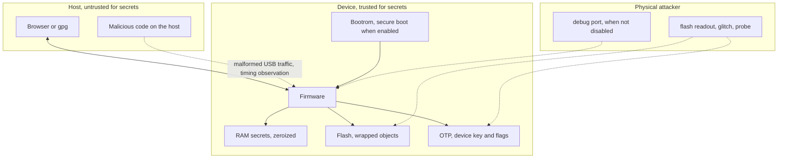
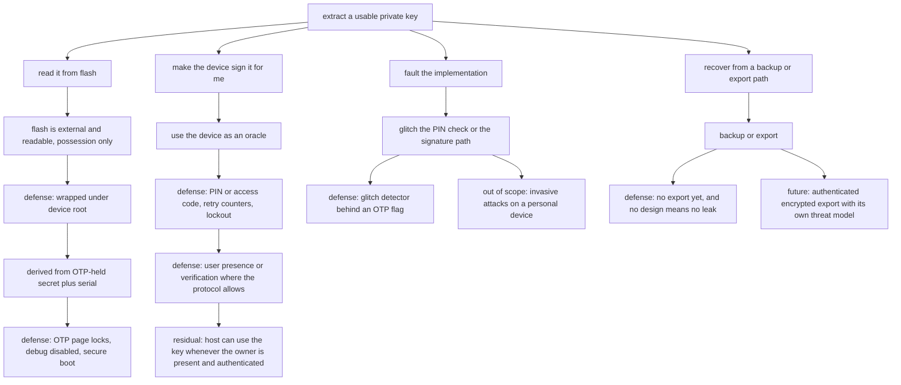

# Threat model: DIY USB hardware key on Pico 2

Status: draft for owner review. This is the artifact `AGENTS.md` requires before any crypto feature is implemented. It defines assets, adversaries, trust boundaries, mitigations, residual risk, and the verification that must exist before any compatibility or security claim is made.

Nothing here is a claim that the device is secure. It is a statement of what is being defended against, what is explicitly not, and what still needs a decision from the owner.

## Scope

In scope: the firmware and storage of a personal USB hardware key built on a Raspberry Pi Pico 2, providing FIDO2/WebAuthn credentials, OATH TOTP/HOTP, and OpenPGP card operations, used on the owner's own machines.

Out of scope for this document: the security of the host operating systems, the security of relying-party servers, the security of the OpenPGP or WebAuthn protocols themselves, and the security of any future PCB.

## Assets

| Asset | Where it lives | Loss impact | Disclosure impact |
| --- | --- | --- | --- |
| FIDO2 credential private keys | device flash, wrapped | loss of account access if not re-enrollable | account takeover at the relying party |
| FIDO2 resident credential metadata and user handles | device flash, wrapped | loss of discoverable credentials | privacy: which services the owner uses |
| OATH shared secrets | device flash, wrapped | loss of second factor for those services | second-factor generation, long-lived |
| OpenPGP private keys | device flash, wrapped (or import path) | loss of signing and decryption ability | impersonation, decryption of past messages |
| PIN and retry counters | flash and RAM | lockout, data loss if unrecoverable | enables the above if guessed |
| Device root key | derived from OTP-held secret plus device serial | all wrapped data becomes undecryptable | unlocks every wrapped object |
| Attestation key material | flash, not yet designed | cannot prove device model to a relying party | weakens attestation honesty |
| Firmware integrity | CPU flashes, boot ROM verifies if enabled | malicious firmware with full key access | full compromise |
| Backup artifact, if ever designed | off-device, TBD | loss of recovery path | potentially every credential at once |

The disclosure column is what makes this device worth attacking. A stolen hardware key is worth more than the sum of its services, because it signs as the owner.

When a wiped but readable device still exists, and the root key was not rotated, the wipe failed.

## Roles and trust boundaries

- **Owner** — the only legitimate user. Holds the PIN, presses the button, owns the machines.
- **Host** — the computer the key is plugged into. Treated as untrusted for secrets, trusted for nothing except being the counterparty. A compromised host can send any USB traffic and observe timing.
- **Relying party** — a website, or a local tool such as `gpg` or `git`. Untrusted for device internals, defines what a successful authentication is.
- **Attacker** — any of the adversary classes below. May be the host, may hold the device, may be remote.
- **Device** — the only place secrets are supposed to exist in the clear.

## Adversaries, in the order that matters

1. **A-1 Malicious or compromised host** — sends malformed CBOR or APDU, replays messages, probes timing, tries to use the device silently. Prerequisite: code execution on the owner's machine. This is the default assumption of every protocol we implement: the host is untrusted.
2. **A-2 Someone holding the device** — plugged into another machine, tries PIN guessing, tries to enumerate contents, tries to use key objects. Prerequisite: physical possession, possibly without the PIN.
3. **A-3 Physical extraction** — reads the external QSPI flash, attempts glitching or fault injection, probes the die, reads the OTP. Prerequisite: possession plus equipment plus time.
4. **A-4 Software supply chain** — malicious dependency, malicious toolchain, or a modified reference project. Prerequisite: the build process.
5. **A-5 Network or file-based attacker against protocols** — forges or replays signatures at the relying party, exploits a parsing bug, exploits weak parameters such as a short TOTP seed or a weak curve.
6. **A-6 The owner's own mistakes** — forgotten PIN, lost device without a recovery path, weak PIN, leaving debug enabled in a "release" build, reusing a credential on a compromised machine.

## Attack tree: extract one private key

## Mitigations mapped to the design

### PIN, retries, and lockout

- FIDO2: PIN stored as a verifier, retry counter persisted, lockout requires a power cycle in the reference implementation, default of 8 retries (`cited` — `pico-fido/src/fido/fido.h:94-98`, and note 03).
- OpenPGP: PW1 for user operations, PW3 for administration, a resetting code for unblocking, retry counters with a default of 3 that block at zero, `63CX` status reporting, and `TERMINATE DF` as the last resort (`cited` — OpenPGP card specification 3.4.1, DO C4 table, §7.2.2, §7.2.4, §7.2.16).
- OATH: optional access code with a reported retry counter (`cited` — `pico-fido/src/fido/oath.c:48-66`).
- **Decision required:** a minimum PIN length and whether the PIN derivation is hardened against offline guessing after a flash dump. The reference derivation chain (HMAC plus HKDF, `cited` — `pico-keys-sdk/src/crypto_utils.c:34-79`) is fast; the mitigations are a stronger KDF, a longer PIN, or reliance on the OTP-held root key so that flash alone is insufficient.

### User presence and verification

- A physical button for user presence, enforced where the protocol requires it. For OpenPGP this is the spec's User Interaction Flag, which aborts with `6600` if the user does not act (`cited` — spec §4.4.3.6).
- For OATH credentials, a per-credential touch property can require presence before computing a code (`cited` — `oath.c:77-78, 1064-1068`).
- Host-side protections in WebAuthn are not a defense for us; they only mean the browser will not silently use an untrusted path.

### Storage and wipe

- Secrets wrapped with a device-bound root, never stored in plaintext (`cited` — the wrapping model in note 07, from `crypto_utils.c:81-140`).
- **Requirement:** a wipe must rotate the root key, not just delete records. Otherwise a wiped device still leaks everything to anyone who reads flash later.
- **Requirement:** retry counter updates must fail closed. A counter that did not persist must not be treated as decremented (`cited` — the bounded commit and verify pattern in the reference PIN and OATH paths).

### Firmware integrity and debug

- Secure boot enforces signatures on every boot medium except the debugger; the documented procedure disables debug using `CRIT1.DEBUG_DISABLE` or `CRIT1.SECURE_DEBUG_DISABLE`, optionally enables the glitch detector with `CRIT1.GLITCH_DETECTOR_ENABLE`, then enables secure boot with `CRIT1.SECURE_BOOT_ENABLE` (`cited` — RP2350 datasheet §10.5, §10.9).
- All of those OTP flags are effectively permanent.
- **Decision required:** whether a "release image" for this project means signed firmware with debug disabled, or whether the owner explicitly accepts open SWD. `AGENTS.md` requires that acceptance to be recorded here.

### Protocol-level hygiene

- Parse defensively at both boundaries: CBOR for CTAP2, APDU for OpenPGP and OATH. Any parsing bug is reachable by a malicious host (A-1), which is the most likely adversary.
- Constant-time handling of PIN comparisons and key operations (note 07).
- Zeroize RAM secrets on every exit path, including errors and resets (note 07).
- Reject malformed input with the protocol's own error codes so hosts fail predictably rather than by timeout.

## Risk register

Severity is impact if exploited; likelihood assumes a competent hobbyist attacker with possession or host access, not a state actor.

| ID | Risk | Severity | Likelihood | Disposition |
| --- | --- | --- | --- | --- |
| R-1 | Flash readout reveals wrapped keys, and the root is only as strong as its protection | High | Medium | Mitigate: OTP-held root, page locks, debug disabled for release images |
| R-2 | PIN or access code guessed, or brute-forced offline after a dump | High | Medium | **Deferred (D-3):** retry counters and lockout now; KDF hardening waits for measured latency |
| R-3 | Malicious host exploits a parser bug in CBOR or APDU handling | High | Medium | Mitigate: defensive parsing, fuzzing, one parser per protocol, negative tests |
| R-4 | Wipe does not destroy recoverability | High | Medium | Mitigate by design: wipe rotates the root key; verify with a read-back test |
| R-5 | Debug port left enabled in a shared or "release" build | High | Low | **Decided (D-2):** OTP debug disable plus signed firmware for release images; open SWD in development only |
| R-6 | Glitch attack bypasses a PIN check | High | Low | Partially mitigate: glitch detector OTP flag; invasive attacks out of scope |
| R-7 | Weak randomness from a starved or failing TRNG | Medium | Low | Mitigate: pool entropy, check status, never fail open (`cited` — datasheet §12.12 caveats) |
| R-8 | TOTP seeds or keys leaked because a service required a short or weak seed | Medium | Low | Accept with rule: follow the standard's minimum seed strength; refuse weaker requests |
| R-9 | No backup path, so flash failure or forgotten PIN loses every credential | High | High | **Accepted (D-1):** reset and re-enroll, no export in the MVP. OpenPGP keys are forfeit on loss |
| R-10 | Weak or missing attestation lets an attacker pass off another device as this one, or lets a DIY key misrepresent itself | Medium | Medium | Decide: self-attestation only, stated honestly; no fake vendor identity |
| R-11 | Malicious dependency or reference code copied under AGPL obligations by accident | Medium | Medium | Mitigate: license check before vendoring, add a LICENSE to this repo |
| R-12 | OTP flags programmed wrongly and irreversibly during development | High | Medium | Mitigate: rehearse on a disposable board, document the exact procedure, no accidental runs |
| R-13 | Host observes timing or traffic volume to learn which services are used | Low | High | Accept: inherent to USB HID and CCID; document it |
| R-14 | Owner leaves a key unlocked, or authenticates while a host is compromised | High | Medium | Accept as user-behaviour risk: document the limits of what the device can defend |

## Decisions

| # | Decision | Status | Record |
| --- | --- | --- | --- |
| D-1 | Backup policy (R-9) | **Decided 2026-09-24: no backup.** Accept reset and re-enroll. A lost flash or forgotten PIN means lost OpenPGP keys; FIDO2 credentials are re-enrolled at each service. No export or backup code is built in the MVP, and any future export design requires its own threat model and a revision of this document | owner |
| D-2 | Release image definition (R-5) | **Decided 2026-09-24: signed firmware with debug disabled via OTP.** Development builds keep SWD open. Nothing irreversible is programmed until the owner approves it for a specific board, and the exact OTP sequence is written down before it is run | owner |
| D-3 | PIN hardening (R-2) | **Deferred.** Rely on the OTP-held root key for now; the KDF choice waits for measured unlock latency from the spike. Until then, the PIN derivation stays as the reference chain (HMAC plus HKDF) and a longer PIN is the interim control | owner, revisit after spike |
| D-4 | Attestation stance (R-10) | Open: self-attestation only, declared honestly, AAGUID either documented as a placeholder or left unset | pending |
| D-5 | Wipe semantics (R-6, D-1) | Open: trigger, user feedback, and confirmation that wipe rotates the root key. With no backup path this is the only recovery, so it must be tested before any credential is enrolled on a device the owner cares about | pending |
| D-6 | OTP plan (R-12) | Open: which flags, in which order, on which board. The rehearsal procedure comes first, on a disposable board | pending |
| D-7 | Decommissioning | Open: what "destroy this key" means, given chip-level decommissioning and RMA flows exist (`cited` — RP2350 datasheet §10.11, §13.7) | pending |

Consequences of D-1 and D-2 that must shape planning:

- With no backup, a flash failure or a forgotten PIN is unrecoverable for OpenPGP keys. Reset must be reliable, tested, and documented before real credentials are enrolled.
- OTP flags are irreversible. The D-2 procedure is the first time this project writes fuses, so it needs a rehearsal board, a written sequence, and an explicit go or no-go from the owner at the time.
- Debug stays open in every image until that point, which is acceptable only for hardware the owner keeps in their possession.

## Verification plan

Each mitigation gets a negative test, not just a happy path. Until a row has evidence, the mitigation is a claim.

| Area | Test | Evidence expected |
| --- | --- | --- |
| Retry counters | Wrong PIN until lockout, confirm `63CX` style reporting and that a power cycle is required | command transcript, counter read-back |
| Counter durability | Interrupt power during a counter write, confirm the counter did not go up | repeated power-cut test |
| Wipe | Wipe, then verify the old wrapped blobs cannot be decrypted with previously captured material | before-and-after dump comparison |
| Parser hardening | Fuzz CBOR and APDU inputs; no crash, no hang, protocol error returned | fuzzing log, corpus committed |
| Constant-time | Review every secret comparison; confirm constant-time helper is actually called in optimized builds | disassembly check, review note |
| Randomness | Check TRNG status handling and pooling under repeated generation | latency distribution, failure-path test |
| Debug disposition | Confirm debug state on the build under test, and record whether it is disabled | `openocd` or `probe-rs` attach attempt |
| Host-side rejection | Malformed `GetInfo`, oversized CBOR, unexpected CTAPHID frames | protocol transcript |
| Reset and wipe | CTAP reset and OpenPGP `TERMINATE DF` behavior, plus the device-level wipe; confirm the root rotated and old blobs are undecryptable | transcript plus read-back, before the owner enrolls anything they care about (D-1, D-5) |

Zeroization cannot be proven by testing, only by review and by never storing what must not persist. Treat it as a review item with disassembly evidence for the release path.

## Explicitly out of scope

- Invasive physical attacks: die probing, decapsulation, focused ion beam work.
- A state-level attacker with a laboratory, and any attacker who can compromise the toolchain before it reaches this machine.
- Side-channel analysis with an oscilloscope or electromagnetic probe. The software does not claim resistance to it.
- Attacks that require modifying the host operating system, beyond the assumption that the host is already untrusted for secrets.
- Denial of service. A bricked or unresponsive key is an inconvenience, not a security incident.
- Anything requiring a secure element, which this board does not have.

## Residual risk statement

With no secure element, an attacker with sustained physical access and equipment can extract secrets from a device whose debug interface is not locked. Everything in this document assumes the owner either keeps the device in their possession or accepts that risk. The realistic goal of this project is a device that resists a malicious host, resists casual possession, and fails predictably — not one that survives an equipped attacker.

For the learning phase, that is the honest standard: secure enough to learn on, with every "secure enough to trust" claim backed by a test above and a label of `tested` or `measured`.

## Sources

Local working copies are gitignored: specs in `ref/specs/`, reference clones in `ref/repos/`.

- RP2350 datasheet §10.5 (secure boot enable procedure, debug disable, glitch detector flag), §10.9, §10.11 and §13.7 (decommissioning), §12.12 (TRNG caveats), chapter 13 (OTP page locks and irreversible flags).
- OpenPGP card specification 3.4.1 — DO C4 retry counters and default value 3, §7.2.2 VERIFY, §7.2.4 RESET RETRY COUNTER, §7.2.16 TERMINATE DF, §4.4.3.6 User Interaction Flag.
- WebAuthn Level 3 and CTAP2 — user presence, user verification, credential protection levels, PIN retry semantics (protocol details in notes 02 and 03).
- [pico-fido source code](https://github.com/polhenarejos/pico-fido) at commit `c260981` — `src/fido/fido.h:94-98` (retry count and power-cycle lock), `src/fido/oath.c:48-78, 1064-1068` (access code tags, touch property), and the project feature list (secure lock against flash dumps, 24-word backup) as prior-art mitigations to study.
- [pico-keys-sdk source code](https://github.com/polhenarejos/pico-keys-sdk) at commit `d075b18` — `src/crypto_utils.c:34-140` (root derivation, PIN derivation chain, AES-GCM wrapping), retry counter commit pattern.
- Notes in this repo that carry the underlying detail: `learn/03-FIDO2-FLOWS.md`, `learn/04-OATH.md`, `learn/05-OPENPGP-CARD.md`, `learn/07-MCU-CRYPTO.md`, `learn/08-RP2350.md`, `learn/11-PRIOR-ART.md`.
