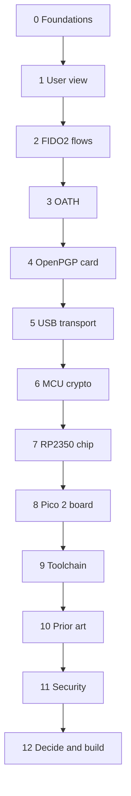

# Learning roadmap: DIY USB hardware key on Pico 2

Top-down order. Start at what a user sees and feels, then drill one layer at a time until you reach silicon and firmware. Each phase ends by writing a `learn/` note. Facts in those notes get labeled `tested`, `measured`, `cited`, or `inferred` per `AGENTS.md`.

How to move: read the phase sources, answer its key questions in plain words, do the hands-on step, write the note. Phases can overlap, but do not skip ahead to implementation before Phase 12.

Phase 9 onward depends on the hardware phases, so it runs in parallel with notes 6 to 8 once the transport picture is clear.

## Phase 0 — Foundations (no hardware needed)

Goal: the minimum vocabulary to read everything below. Sources: [RFC 6238](https://datatracker.ietf.org/doc/html/rfc6238) §5.2 for why the hash-then-truncate shape exists (reused in Phase 3).

- Public-key intuition: keypair, sign/verify, encrypt/decrypt, certificates. Who holds what, what the attacker sees.
- Symmetric basics: AES, HMAC, SHA-256. What a hash, MAC, and nonce are for.
- Numbers on the wire: binary, hex, base64, CBOR in one paragraph each.
- USB intuition: host vs device, endpoints, HID. A key is a USB *device* that speaks strict protocols.
- Safety: USB power only, check pinout before power, no mains work.

Hands-on: encode/decode short strings in hex and base64 by hand or with a calculator.
Exit: `learn/01-FOUNDATIONS.md` — define each term in your own words.

## Phase 1 — The user view: what using a key feels like

Goal: know the product before the protocol.

- WebAuthn UX: register ("create a passkey") vs authenticate ("sign in with key"). Touch/PIN prompts, what the browser shows.
- Passkey flavors: device-bound credential on a key vs synced passkey in a phone/cloud. What "resident/discoverable credential" means to a user.
- PIN, user verification, user presence: which gesture proves what.
- Attestation at UX level: the site learning "this is a genuine key model" — and why privacy modes exist.
- TOTP/HOTP UX: typing a 6-digit code, time sync problems, counters desyncing.
- OpenPGP card UX: `gpg --card-status`, decrypt/sign with touch, SSH login via `gpg-agent`.

Hands-on: if you can borrow any FIDO2 key, register it on a demo site and watch each prompt. Otherwise walk a browser demo and screenshot each step.
Exit: `learn/02-USER-VIEW.md` — one flow diagram per feature in words.

## Phase 2 — FIDO2 and WebAuthn: the auth flows

Goal: the two ceremonies cold. Sources: [WebAuthn Level 3](https://www.w3.org/TR/webauthn-3/), [CTAP2 spec](https://fidoalliance.org/specs/fido-v2.0-ps-20190130/fido-client-to-authenticator-protocol-v2.0-ps-20190130.html).

- The three parties: relying party (server), client (browser/OS), authenticator (your key). Who talks to whom.
- Registration ceremony: challenge, `rp`, `user`, `pubKeyCredParams`, attestation format, `authenticatorSelection`, extensions. What the key generates, stores, and returns.
- Authentication ceremony: `allowCredentials`, challenge, `userVerification`, signature, sign counter. What the key signs and why replay fails.
- Attestation formats and why a DIY key starts with self-attestation.
- CTAP2 commands: `authenticatorMakeCredential`, `authenticatorGetAssertion`, `authenticatorGetInfo`, ClientPIN, CredentialManagement, selections and resets.
- CTAP1/U2F compatibility: why old keys still work and what you must keep speaking.
- PIN/UV auth protocol: how the PIN travels without leaking, retry counters, lockout.
- Extensions you will choose between: `hmac-secret`, `credProtect`, `credBlob`, `largeBlobs`, `minPinLength`.

Hands-on: capture a real or demo ceremony and label every field with who produced it.
Exit: `learn/03-FIDO2-FLOWS.md` — registration and authentication traced end to end, each message attributed.

## Phase 3 — OATH: TOTP and HOTP

Goal: one-time passwords demystified. Sources: [RFC 4226](https://datatracker.ietf.org/doc/html/rfc4226) (HOTP), [RFC 6238](https://datatracker.ietf.org/doc/html/rfc6238) (TOTP) — retry on DNS; 6238 already confirmed fetchable.

- HOTP: counter, HMAC truncation, dynamic truncation, resync windows.
- TOTP: time steps, period, clock skew, look-ahead/look-behind.
- Parameters that must match both sides: algorithm, digits, period, secret encoding.
- YKOATH protocol: how apps list and compute codes on a key.
- Challenge-response and keyboard-emulation OTP (type-the-code keys).

Hands-on: compute a TOTP for a known test vector by hand or script and match it.
Exit: `learn/04-OATH.md` — parameters table plus one worked test vector.

## Phase 4 — OpenPGP card: sign, decrypt, authenticate

Goal: the smartcard model. Sources: OpenPGP card specification, `gpg` documentation.

- Card model: key slots for signature, decryption, authentication. What each slot may and may not do.
- PIN/PUK plus retry counters, touch policies, key import vs on-card generation.
- Host side: `gpg --card-status`, encrypt/decrypt round-trip, SSH via `gpg-agent`.
- What "OpenPGP support" obligates: APDU transport (CCID), PIN behavior, negative paths.

Hands-on: none on hardware yet; map each `gpg` operation to the card command behind it from the spec.
Exit: `learn/05-OPENPGP-CARD.md` — slot model, PIN states, and the minimum command set.

## Phase 5 — USB transport: how the key speaks

Goal: bytes on the wire. Sources: RP2350 datasheet section 12.7 (USB controller), CTAP2 spec transport parts.

- USB device model: descriptors, configurations, interfaces, endpoints. Full-speed (USB 1.1) limits your key lives inside.
- CTAPHID: how FIDO2 rides HID packets; message framing and busy/error handling.
- CCID: how smartcard bytes ride USB for the OpenPGP side.
- Composite devices: FIDO + CCID + keyboard interfaces on one device, endpoint budgeting.
- Debugging: `lsusb`, USB packet capture, descriptor decoding.

Hands-on: decode a captured descriptor set field by field (from docs or a real key).
Exit: `learn/06-USB-TRANSPORT.md` — descriptor map and the endpoint budget for a three-interface key.

## Phase 6 — Crypto on a small MCU

Goal: what is cheap, what is expensive, what is dangerous.

- Curves: P-256 and Ed25519 as the workhorses; what ECDSA/EdDSA signing costs on a 150 MHz core.
- ECDH, AES modes, RSA keygen cost (why RSA-4096 on-device is slow).
- HMAC/KDFs, PIN hashing, wrapping keys so flash never holds plaintext.
- TRNG seeding: hardware randomness in, deterministic expansion out.
- Constant-time discipline: no secret-dependent branches or memory access.
- PIN retry counters, lockout, wipe, zeroization on failure and reset.

Hands-on: none yet; collect cost numbers from prior-art docs and datasheets as `cited`.
Exit: `learn/07-MCU-CRYPTO.md` — primitive cost table and the storage rules (wrap, counters, wipe).

## Phase 7 — RP2350: the chip

Goal: know your silicon. Source: RP2350 datasheet (already fetched locally; cite chapter/section).

- Cores and clocks: dual Cortex-M33 or Hazard3 at 150 MHz, what runs where.
- Memory: 520 KB SRAM in 10 banks, external QSPI flash/XIP, 8 KB OTP.
- Security: TRNG (12.12), SHA-256 accelerator (12.13), secure boot and OTP protections (chapters 10 and 13), glitch-detector mitigations.
- USB controller (12.7), SWD debug, decommissioning.
- What the chip can and cannot do for you: no secure element, flash is readable, so keys must be wrapped and debug locked.

Hands-on: read-only; every claim cites a datasheet section.
Exit: `learn/08-RP2350.md` — memory map in your words, security features with section cites, open questions list.

## Phase 8 — Pico 2: the board

Goal: board facts before power. Source: official Pico 2 board documentation (fetch pending — the PDF fetch failed; retry before trusting specifics).

- Flash size on your board revision, USB connector type, pinout, power rails.
- BOOTSEL flashing flow, SWD pins, onboard button and LED for user presence.
- Schematic reading basics: find power, ground, USB data pins, reset.
- Safe first power-up checklist.

Hands-on: identify every pin you will use on the schematic before connecting anything.
Exit: `learn/09-PICO2-BOARD.md` — board facts with doc cites, plus your power-up checklist.

## Phase 9 — Toolchain and firmware stack

**Decided 2026-09-27: Rust with Embassy, built in a Nix dev shell.** See [`docs/reviews/toolchain.md`](../docs/reviews/toolchain.md).

- Language and runtime: Rust `no_std` plus Embassy, RustCrypto crates, target `thumbv8m.main-none-eabihf`, `embassy-rp` feature `rp235xa`.
- Starting point: a port of `r17c` (RP2040, Rust, Embassy) used with the author's permission, credited in the firmware repo's `NOTICE`.
- Rejected: C with the Pico SDK (protocol cross-check material only), the synchronous `usb-device` stack, Trussed, Nushell.
- Port work: target and HAL feature switch, TRNG instead of ROSC entropy, flash map re-derived for 4 MB, GPIO user-presence button.

Hands-on: port the USB stack (HID plus CCID) to `rp235xa`, then measure flash, RAM, and latency.
Exit: `docs/reviews/toolchain.md` with the decision recorded, and the firmware repository created once the port starts.

## Phase 10 — Prior art dissected

Goal: steal architecture, not code. Sources: `polhenarejos/pico-fido`, `polhenarejos/pico-hsm`, `pico-keys-sdk` repos.

- `pico-fido`: CTAP loop, credential storage, OATH container, USB device stack, PIN handling, tests.
- `pico-hsm`: key containers, PIN/PUK, APDU dispatch, encrypted storage model.
- `pico-keys-sdk`: what is shared glue and what is app logic.
- For each: what to borrow, what to rewrite, license check, what not to copy (keys, certs, test secrets).

Hands-on: build one reference project unmodified and enumerate with `lsusb`.
Exit: `learn/11-PRIOR-ART.md` — architecture sketches plus borrow/rewrite lists.

## Phase 11 — Security engineering

Goal: the threat model before the first crypto feature.

- Assets, attackers, trust boundaries: malicious host, thief with the key, supply chain, side channels, glitching.
- PIN/PUK policies, retry counters, lockout, wipe, backup and restore, attestation story, decommissioning.
- Debug lockdown: when SWD stays open and the exact decision that closes it.
- What "secure enough to learn on" vs "secure enough to trust" means for this project.

Hands-on: write the threat model as scenarios, not adjectives.
Exit: `docs/reviews/threat-model.md`, referenced by every later feature plan.

## Phase 12 — Decide, then build

Goal: turn learning into a scoped plan.

- Feature shortlist with threat-model and resource justification per feature.
- Toolchain decision recorded.
- MVP spike order (suggested): USB echo → CTAPHID `GetInfo` → `MakeCredential` with test keys → `GetAssertion` → OATH slot → OpenPGP slot.
- Interop test plan: browsers, OS versions, `gpg`, smartcard and OATH tools, negative paths.

Exit: `docs/plans/` entries per the task matrix, implementation only on explicit ask.

## Fact status

- `cited`: RP2350 core/SRAM/OTP/USB/TRNG/SHA-256/secure-boot facts (datasheet ch. 1, 10, 12.7, 12.12, 12.13, 13); `pico-fido` features (CTAP 2.3/U2F/OATH/TOTP/Yubico-app compat, from its README); `pico-hsm` capabilities (key gen/storage, AES/RSA/ECDSA, smartcard interface, from its README); TOTP standard (RFC 6238, fetched).
- `inferred`: phase ordering, MVP spike order, cost intuitions — validate in notes.
- Unverified: the CTAP2 specification text, because the FIDO Alliance site returns 403 to automated fetches; notes cite the `pico-fido` implementation instead. Pico 2 board specifics are now cited in `learn/09-PICO2-BOARD.md` from the board datasheet, and the OATH RFCs are local.

## Sources

Local working copies live in `ref/` and are gitignored: specs in `ref/specs/`, reference clones in `ref/repos/`. The URLs below are authoritative; `ref/SOURCES.md` records what was fetched and when.

- [RP2350 datasheet](https://datasheets.raspberrypi.com/rp2350/rp2350-datasheet.pdf) — ch. 1, 5, 8, 10, 12.7, 12.12, 12.13, 13, 14. Local copy: `ref/specs/rp2350-datasheet.pdf`.
- [Pico 2 datasheet](https://datasheets.raspberrypi.com/pico/pico-2-datasheet.pdf) — pins, power chain, flashing, GPIO limits. Local copy: `ref/specs/pico-2-datasheet.pdf`.
- [WebAuthn Level 3](https://www.w3.org/TR/webauthn-3/).
- [CTAP2 specification](https://fidoalliance.org/specs/fido-v2.0-ps-20190130/fido-client-to-authenticator-protocol-v2.0-ps-20190130.html).
- [RFC 4226](https://datatracker.ietf.org/doc/html/rfc4226) HOTP, [RFC 6238](https://datatracker.ietf.org/doc/html/rfc6238) TOTP.
- OpenPGP card specification; `gpg` documentation.
- [polhenarejos/pico-fido](https://github.com/polhenarejos/pico-fido), [polhenarejos/pico-hsm](https://github.com/polhenarejos/pico-hsm) (plus [pico-keys-sdk source code](https://github.com/polhenarejos/pico-keys-sdk) inside each).
