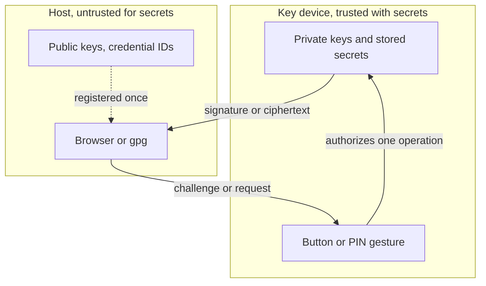
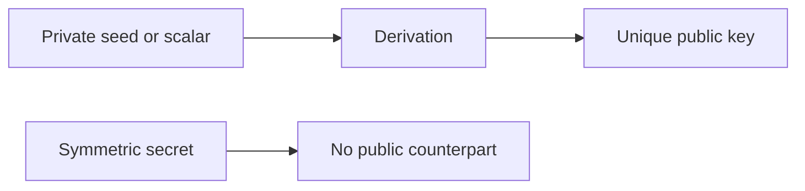
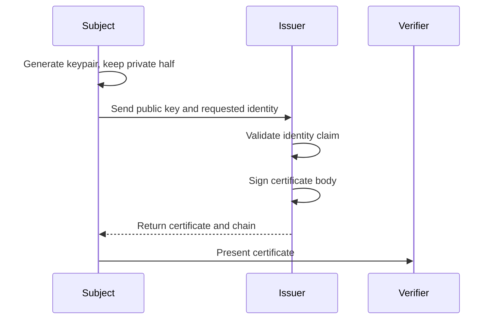
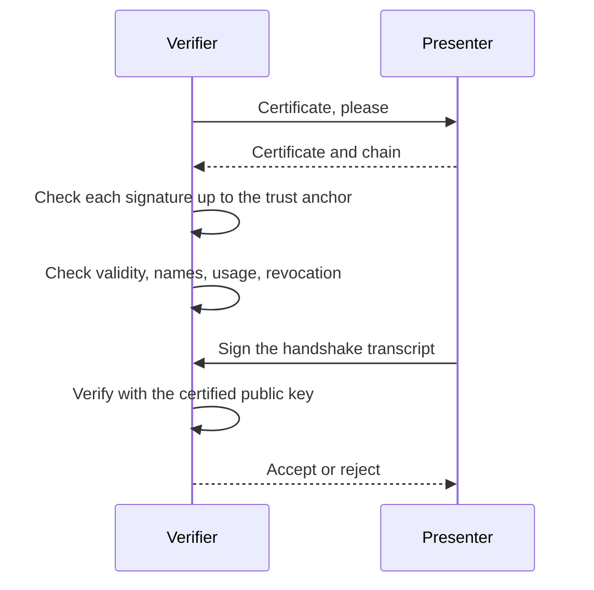
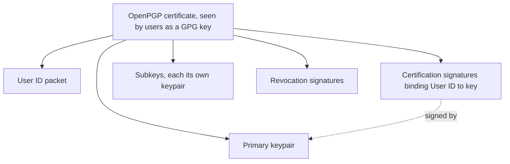

# 01 — Foundations

Minimum vocabulary for everything downstream. Each term defined in plain words plus the one mental picture that makes it stick. Facts: `cited`. Analogies: `inferred`.

## Public-key intuition

A keypair is two mathematically linked numbers: a private key you never show and a public key you hand out freely. `cited` — standard definitions, e.g. [RFC 5280 §3](https://datatracker.ietf.org/doc/html/rfc5280#section-3) for certificates and [WebAuthn §5](https://www.w3.org/TR/webauthn-3/#sctn-credential-creation) for how credentials use them.

- **Sign/verify.** Signing takes your private key plus a message and produces a signature. Anyone with the public key can verify the signature came from you and the message is unchanged. Picture: a wax seal. Only your ring makes it, anyone can recognize it, nobody can copy it from the impression.
- **Encrypt/decrypt.** Encryption takes the recipient's public key plus a message and produces ciphertext only their private key opens. Picture: a padlock anyone can snap shut, only one key opens.
- **Certificates.** A certificate is someone else's signed statement saying "this public key belongs to this name". Your browser trusts thousands of pre-installed authority keys, and chains from those. Picture: a passport office stamping an ID card.

Who holds what on a hardware key: private keys never leave the device; the host sees public keys, signatures, and ciphertext only. An attacker watching USB traffic learns public material plus metadata (timing, sizes), never secrets.

## Symmetric basics

One shared secret does everything; both sides must already know it. `cited` — [RFC 6238 §5.2](https://datatracker.ietf.org/doc/html/rfc6238#section-5.2) shows HMAC-SHA used exactly this way for OTP.

- **Hash (SHA-256).** One-way fingerprint: arbitrary input in, fixed 32 bytes out. Changing one input bit scrambles the output. Cannot be reversed. Picture: a blender — smoothy never becomes fruit again.
- **MAC/HMAC.** A hash mixed with a secret key, proving both integrity and "someone holding the key touched this". Picture: the wax seal again, but both sides own identical rings.
- **Nonce.** A number used once per operation: challenges, salts, IVs. Its job is making every run unique so replays fail. Picture: a serial number on each seal impression.
- **AES.** The standard symmetric cipher: secret key plus nonce/IV turns plaintext into ciphertext and back. Your key will use it to wrap stored secrets so flash never holds plaintext.

## Numbers on the wire

- **Binary.** Base-2, the actual bits. A byte is 8 bits, values 0–255.
- **Hex.** Base-16, two characters per byte. Human-readable form of binary; `deadbeef` is 4 bytes.
- **Base64.** Denser text encoding for binary, ~4 characters per 3 bytes. Shows up in WebAuthn JSON and PEM files.
- **CBOR.** Binary JSON: same maps/arrays/strings, but compact byte form. CTAP2 speaks CBOR because USB HID packets are tiny and every byte counts.

Hands-on check: `echo -n hi | xxd -p` gives `6869`; `echo -n hi | base64` gives `aGk=`.

## USB intuition

- **Host vs device.** The PC/phone is the host and runs the show; your key is the device and only answers. The key never initiates.
- **Endpoints.** Numbered one-way pipes: control (setup), interrupt (small frequent packets, e.g. HID), bulk (large transfers). A device declares them in descriptors; the host reads the descriptors and learns what the device is.
- **HID.** Human Interface Device class: keyboards, mice — and FIDO2 keys, which ride HID packets (CTAPHID) so no special driver is needed.
- **Your key's view.** It sits silent until polled, answers strictly formatted packets, and knows three tricks later: FIDO HID for passkeys, CCID smartcard for OpenPGP, keyboard emulation for OTP.

## Safety

- USB power only. The PC's port powers the board; no external supply without a reviewed design.
- Check the pinout and schematic before applying power. Shorting 5V to a GPIO kills the chip.
- Solder later, learn first. Nothing in Phases 0–8 needs a soldering iron.
- Mains and high voltage stay out of this repo entirely.

## Keypairs, certificates, and OpenPGP keys

Frequently Asked Questions (FAQ)

### Does a private key always have a public key?

For asymmetric algorithms, yes: the public key is derived from the private key, so the pair always exists even when only the private half is stored. In elliptic-curve systems the public key is the private scalar multiplied by the curve base point, and in Ed25519 it is a deterministic function of the 32-byte seed. In RSA the private key material carries the modulus, and the public exponent is a fixed convention or stored alongside (`cited` — [RFC 5280 §4.1.2.7](https://datatracker.ietf.org/doc/html/rfc5280#section-4.1.2.7) defines the public key field; derivation is standard algorithm behavior, `inferred` from textbooks rather than quoted here).

Symmetric secrets are the exception. An AES key, an HMAC key, or a TOTP seed has no public counterpart at all, because both sides hold the same secret. That is why a TOTP seed can never be published the way a public key can, and why RFC 4226 demands a shared secret of at least 128 bits (`cited` — [RFC 4226 §7.2 R6](https://datatracker.ietf.org/doc/html/rfc4226#section-7.2)).

### One private key, how many public keys?

Exactly one per keypair, for two reasons. The derivation is a function, so one private value maps to one public value; and a public key is just data, so copies cost nothing. The same public key therefore appears in many places and can appear in many certificates, but those certificates are separate signed statements about the same key, not separate keys.

What does multiply is keypairs derived from one seed: an OpenPGP primary key can own several subkeys, and the same idea underlies hierarchical wallets (`cited` — [RFC 9580 §10.1.1](https://datatracker.ietf.org/doc/html/rfc9580#section-10.1.1) shows subkeys as distinct keypairs inside one certificate). Reusing one keypair across SSH, `gpg`, and TLS is technically possible and is bad practice, because one leak then compromises every use at once.

### What is a certificate?

A certificate is a signed statement binding an identity to a public key, plus the metadata a verifier needs: version, serial number, signature algorithm, issuer, validity window, subject, the public key itself, and extensions (`cited` — [RFC 5280 §4.1.2](https://datatracker.ietf.org/doc/html/rfc5280#section-4.1.2)). It is not proof of honesty; it is proof that whoever signed it vouched for that binding.

### Who is who

- **Subject** — also called the end entity or subscriber. It is the entity named in the certificate and the owner of the public key being certified. RFC 5280's role list calls it the user of PKI certificates, or the end system that is the subject of a certificate (`cited` — [RFC 5280 §1.3](https://datatracker.ietf.org/doc/html/rfc5280#section-1.3)).
- **Issuer** — a certification authority (CA). It signs the certificate. The issuer field "identifies the entity that has signed and issued the certificate" (`cited` — [RFC 5280 §4.1.2.4](https://datatracker.ietf.org/doc/html/rfc5280#section-4.1.2.4)).
- **Registration authority** — an optional delegate to which a CA hands identity vetting (`cited` — same role list).
- **Verifier** — the relying party, or certificate user in the standard's wording. It checks the certificate and then decides whether to rely on the binding.
- **Trust anchor** — the issuer key the verifier already trusts before any check starts. Every path begins here (`cited` — §6.1).
- **Repository** — where certificates and revocation lists get published.

Every certificate field belongs to one of these roles:

| Field | Filled by | Meaning |
| --- | --- | --- |
| `subject` | Subject | Who the binding is about |
| `subjectPublicKeyInfo` | Subject | The public key being certified |
| `issuer`, `signature` | Issuer | Who vouched, and their signature |
| `validity` | Issuer policy | Not-before and not-after |
| `serialNumber` | Issuer | Unique handle inside that issuer |
| `extensions` | Issuer policy | Name lists, allowed usages, constraints |

### Flow 1: issuance

1. The subject generates a keypair. The private half is never sent anywhere.
2. The subject sends the public key plus the identity it wants certified to the issuer. In PKI practice this message is a certificate signing request.
3. The issuer validates the identity claim. For a domain-validated certificate the only required check is effective control of the domain, which the ACME server performs by fetching an `http-01` token or looking up a `dns-01` TXT record, and the standard is explicit that the CA "is not required to attempt to verify the requester's real-world identity" (`cited` — [RFC 8555 §1.2](https://datatracker.ietf.org/doc/html/rfc8555#section-1.2)).
4. The issuer builds the certificate body, hashes it, and signs the hash with its own private key.
5. The issuer returns the certificate and its chain, and the subject installs them.

### Flow 2: verification

1. The verifier receives the certificate, for example in a TLS handshake.
2. It reads the issuer and locates that issuer's own certificate, then repeats upward. The ordering rule is mechanical: the subject of each certificate is the issuer of the next one, the first certificate is issued by the trust anchor, and the certificate being validated is the last in the chain (`cited` — [RFC 5280 §6.1](https://datatracker.ietf.org/doc/html/rfc5280#section-6.1)).
3. At each link it verifies the signature with the issuer's public key and checks the validity window.
4. It checks the extensions that carry purpose. The subject alternative name must match the name the verifier wanted, and key usage must permit the operation (`cited` — §4.2.1.6).
5. It checks revocation, through a CRL or OCSP, or simply relies on expiry.
6. It confirms the presenter actually holds the private key. A certificate proves a binding, not possession, so TLS 1.3 adds a `CertificateVerify` message in which the peer signs over the handshake transcript (`cited` — [RFC 8446](https://datatracker.ietf.org/doc/html/rfc8446), handshake flow and signature-based authentication description). That signature is what a copied certificate cannot produce.

### The same roles in our three worlds

| World | Subject | Issuer | Verifier | Possession check |
| --- | --- | --- | --- | --- |
| TLS and the web | Website operator | Public CA | Browser | `CertificateVerify` signature |
| FIDO2 attestation | Authenticator vendor or model | Attestation CA, optional | Relying party | Assertion signature, see note 03 |
| OpenPGP and GPG | Key owner | Self, plus anyone who certifies | Whoever chooses to trust | Signed message or decrypted challenge |

OpenPGP is the outlier. It has no obligatory CA: the certificate is self-certified by its own primary key, third-party certifications only express opinions, and trust comes from a web of trust or from pinning a key you already checked (`cited` — [RFC 9580 §10.1.1](https://datatracker.ietf.org/doc/html/rfc9580#section-10.1.1) for the self-certified structure, §5.2.3.10 for self-signatures). That is why the same cryptographic building blocks end up with two completely different trust models.

### Why is a GPG key called a container?

Because a single OpenPGP certificate file is a packet bundle, not one key. RFC 9580 describes it as a primary key, optional revocation signatures, a direct key signature, one or more user IDs each carrying certification signatures, and optional subkeys with their binding signatures (`cited` — [RFC 9580 §10.1.1](https://datatracker.ietf.org/doc/html/rfc9580#section-10.1.1)). The same section keeps the certificate distinct from "its constituent Public Key packets" and "the underlying cryptographic key material", which is the container idea in the standard's own words.

### Is an SSH key non-transferable while a GPG key is transferable?

Not the real difference. User can copy SSH public keys into `authorized_keys` all the time, so SSH keys travel. What OpenPGP calls transferable is self-describing: the file carries the key material, the identity binding, and the signatures that prove the binding, so it can be handed to a stranger and still be interpretable (`cited` — [RFC 9580 §10.1](https://datatracker.ietf.org/doc/html/rfc9580#section-10.1)).

The plain SSH public key has nothing signed inside it. OpenSSH's own description of its base protocol says SSH "eschews the use of X.509 certificates and uses raw keys", and trust is decided by a server-side file plus first-use caching (`cited` — [OpenSSH PROTOCOL.certkeys](https://raw.githubusercontent.com/openssh/openssh-portable/V_10_0_P1/PROTOCOL.certkeys)). SSH certificates exist as an extension adding "a key, some identity information and usage options that have been signed" by a certificate authority (`cited` — same document), which lands closer to the X.509 model.

| Property                         | Plain SSH key          | OpenPGP certificate                  | X.509 certificate         |
| -------------------------------- | ---------------------- | ------------------------------------ | ------------------------- |
| Identity binding inside the file | No                     | Yes, self and third-party signatures | Yes, issuer signature     |
| Who decides trust                | Server file, first use | Web of trust or pinned key           | Trust anchor chain        |
| Revocation                       | Remove the line        | Revocation signature                 | CRL or OCSP               |
| Typical roles                    | Login                  | Sign, encrypt, certify               | TLS, client auth, signing |

## Sources

- [RFC 5280 §3](https://datatracker.ietf.org/doc/html/rfc5280#section-3), [§1.3](https://datatracker.ietf.org/doc/html/rfc5280#section-1.3), [§4.1.2](https://datatracker.ietf.org/doc/html/rfc5280#section-4.1.2), [§6.1](https://datatracker.ietf.org/doc/html/rfc5280#section-6.1) — PKI roles, certificate fields, path validation, trust anchors (`cited`).
- [RFC 8555](https://datatracker.ietf.org/doc/html/rfc8555) — ACME issuance, domain-validated certificates, `http-01` and `dns-01` challenges (`cited`).
- [RFC 8446](https://datatracker.ietf.org/doc/html/rfc8446) — TLS 1.3 handshake, `CertificateVerify`, signature over the handshake transcript (`cited`).
- [RFC 9580 §10.1](https://datatracker.ietf.org/doc/html/rfc9580#section-10.1), [§10.1.1](https://datatracker.ietf.org/doc/html/rfc9580#section-10.1.1) — OpenPGP certificate packet structure, subkeys, transferable keys (`cited`).
- [OpenSSH PROTOCOL.certkeys](https://raw.githubusercontent.com/openssh/openssh-portable/V_10_0_P1/PROTOCOL.certkeys) — SSH raw keys versus SSH certificates (`cited`).
- [RFC 4226 §7.2](https://datatracker.ietf.org/doc/html/rfc4226#section-7.2) — shared-secret requirements (`cited`).
- [RFC 6238 §5.2](https://datatracker.ietf.org/doc/html/rfc6238#section-5.2) — HMAC-based truncation shape (`cited`).
- [WebAuthn Level 3 §5](https://www.w3.org/TR/webauthn-3/#sctn-credential-creation) — credential public-key model (`cited`).
- Wax-seal, blender, padlock pictures (`inferred` — teaching aids, not facts).
- Keypair derivation details beyond the X.509 field definitions (`inferred` — standard algorithm behavior, not quoted from a spec here).
