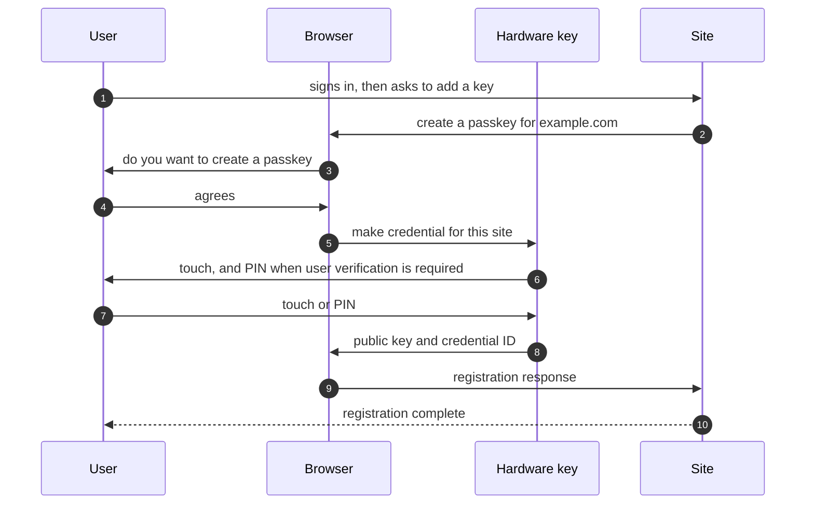
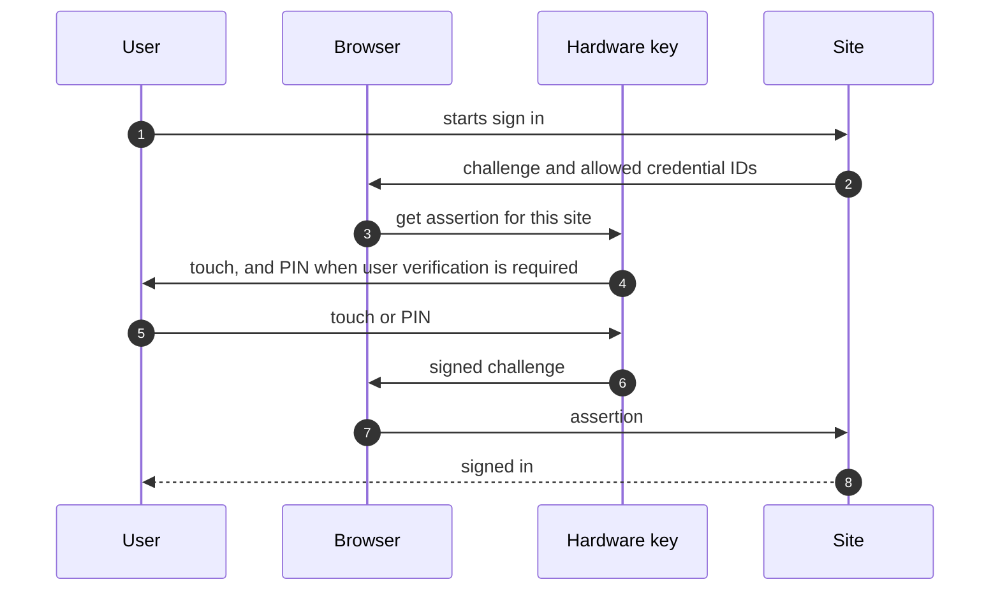
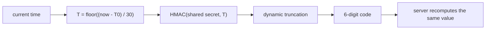

# 02 — User view: what using a hardware key feels like

Product-level picture before any protocol detail. Sources: WebAuthn Level 3 (downloaded locally), RFC 4226, RFC 6238, OpenPGP card spec 3.4.1, plus prior-art READMEs. Facts labeled `cited`; teaching framing labeled `inferred`.

## Registration (creating a passkey)

WebAuthn's own consumer example describes the flow in user terms (`cited` — [WebAuthn L3 §1.2.1.1](https://www.w3.org/TR/webauthn-3/#sctn-registering-a-new-credential)):

1. User signs in some other way on a site, then asks to add a key.
2. Browser prompts: "Do you want to create a passkey for example.com?"
3. User agrees.
4. Browser asks for the authorization gesture already configured on the device: PIN, biometric, or a touch.
5. Site reports registration complete.

For a hardware key, step 4 is normally a **touch** (user presence). If the site requested user verification, it is the key's PIN.

## Authentication (signing in)

(`cited` — same section, authentication half.)

1. User enters their username (or the site goes passwordless).
2. Browser asks for the key.
3. User touches it, or enters the key's PIN.
4. Site verifies a signature made with the stored private key. Password is never typed, and the signature cannot be replayed.

The point of the whole design, in one line: the site keeps a public key, the key keeps the private half, and the user's gesture authorizes one signature.

## Vocabulary that trips people up

- **User presence (UP)** — a simple test that a human is there, typically a touch. Provides consent, not identity.
- **User verification (UV)** — stronger: PIN or biometric, checked by the authenticator. WebAuthn describes the authorization gesture as possibly involving UV when the authenticator is capable, or "a simple test of user presence" otherwise (`cited` — [WebAuthn L3 §1.2.1](https://www.w3.org/TR/webauthn-3/#sctn-use-cases)).
- **Discoverable credential = resident credential = "passkey"** — WebAuthn notes the historical names and defines a discoverable credential as one usable in authentication when the site supplies no credential ID (`cited` — [WebAuthn L3 §4 terminology](https://www.w3.org/TR/webauthn-3/#sctn-terminology)). Practical meaning: the credential lives on the key, so the key can be used without first telling it which account.
- **Synced vs device-bound passkey** — WebAuthn calls out multi-device credentials (backed-up credential sources) versus credentials that stay on one authenticator (`cited` — §1.2.1 example, §6.1.3). A hardware key is the device-bound flavor by default; a phone password manager is usually the synced flavor.
- **Attestation** — evidence about the origin of the authenticator, delivered inside the registration response as an attestation statement, covering things like credential IDs and key pairs (`cited` — [WebAuthn L3 §6.5](https://www.w3.org/TR/webauthn-3/#sctn-attestation)). UX consequence: a site may display "registered a security key", and a DIY key can only honestly claim self-attestation unless you build a real attestation identity.
- **Signature counter** — WebAuthn treats it as optional but meaningful anti-cloning signal (`cited` — §6.1.1). UX consequence: some sites warn when the counter goes backwards; a key that never increments can be flagged.

## TOTP and HOTP, as the user meets them

- Six digits, refreshed on a **30-second** time step by default; TOTP is defined as HOTP with a time-derived counter, where the time step X defaults to 30 s and T0 to the Unix epoch (`cited` — [RFC 6238 §4.1](https://datatracker.ietf.org/doc/html/rfc6238#section-4.1)).
- The user experience problem is clock skew and wrong device time; look-ahead windows exist to tolerate it (`inferred` from the spec's parameters).
- HOTP has a **counter** instead of a clock, so the user experience problem is desynchronization; RFC 4226 specifies a resynchronization mechanism for exactly that (`cited` — [RFC 4226 §7.4](https://datatracker.ietf.org/doc/html/rfc4226#section-7.4)).
- Shared-secret hygiene matters even for OTP: RFC 4226 requires a strong shared secret of at least 128 bits and recommends 160 (`cited` — §7.2 R6).
- Real products add conveniences: list codes in an app (Yubico Authenticator over YKOATH) or type the code over USB as a keyboard (Yubico OTP). Both appear in `pico-fido` README (`cited` — project README).

## OpenPGP card, as the user meets it

- The card model has three **key slots**: signature, decryption, and authentication (`cited` — OpenPGP card spec 3.4.1, card status data).
- Two passwords: **PW1** is the user password used for signing and decryption operations, **PW3** is the admin security-officer password for managing the card (`cited` — spec §4.1.x passwords).
- Retry counters govern how many wrong PIN attempts are allowed before the card locks or the password must be unblocked (`cited` — spec, password and retry-counter data objects).
- The everyday gestures are: plug in, run `gpg --card-status`, be prompted for the PIN, touch to sign or decrypt, and use the same key for SSH through `gpg-agent`. Touch policy is device-specific, so treat "touch to sign" as product behavior, not as a spec guarantee (`inferred`).
- Contrast with FIDO2 in user terms: FIDO2 authenticates to a website with no secret typed; OpenPGP signs, decrypts, and authenticates for tools like mail, Git, and SSH.

## What this obliges a DIY key to do

- Registration and authentication prompts must be answerable by one button and, when UV is requested, by a PIN with visible retry behavior.
- Attestation must be honest: self-attestation by default.
- A discoverable-credential mode means on-key credential storage plus a way to clear it (reset).
- For OATH: real time-keeping or host-supplied time, plus a counter that survives resets.
- For OpenPGP: three slots, two PINs, retry counters that lock predictably, and a status command that host tools can read.

## Open questions

- Which of UP-only, UV-capable, or both the first firmware targets.
- Whether the button is enough for touch policy or a second input (LED/capacitive) is wanted.
- How the user will set and change the PIN without a vendor app.
- Whether host time is trusted for TOTP or the device keeps its own clock.

## Sources

- [WebAuthn L3](https://www.w3.org/TR/webauthn-3/) §1.2.1, §4 terminology, §6.1.1, §6.1.3, §6.5.
- [RFC 4226](https://datatracker.ietf.org/doc/html/rfc4226) §7.2, §7.4.
- [RFC 6238](https://datatracker.ietf.org/doc/html/rfc6238) §4.1.
- [OpenPGP card spec 3.4.1](https://gnupg.org/ftp/specs/OpenPGP-smart-card-application-3.4.1.pdf) — passwords, key slots, retry counters.
- [polhenarejos/pico-fido](https://github.com/polhenarejos/pico-fido) README — YKOATH app compatibility, Yubico OTP keyboard mode.
- Note: the FIDO Alliance site returned 403 to automated fetches, so CTAP2-level UX claims wait for note 03 and will lean on the pico-fido implementation as a secondary reference.
