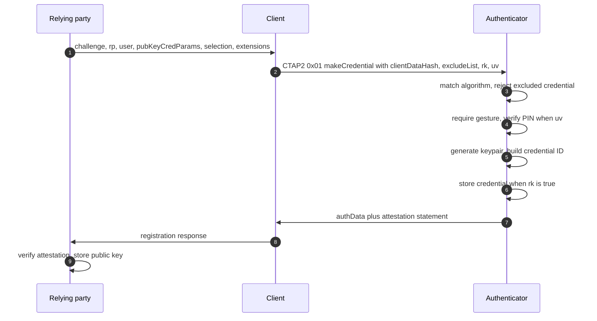
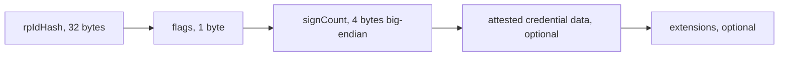
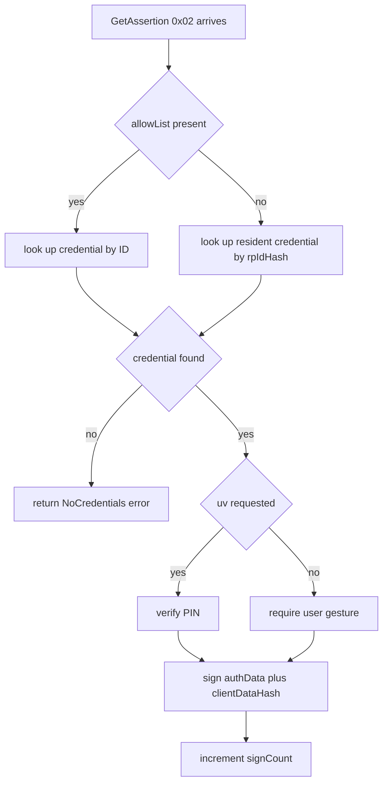
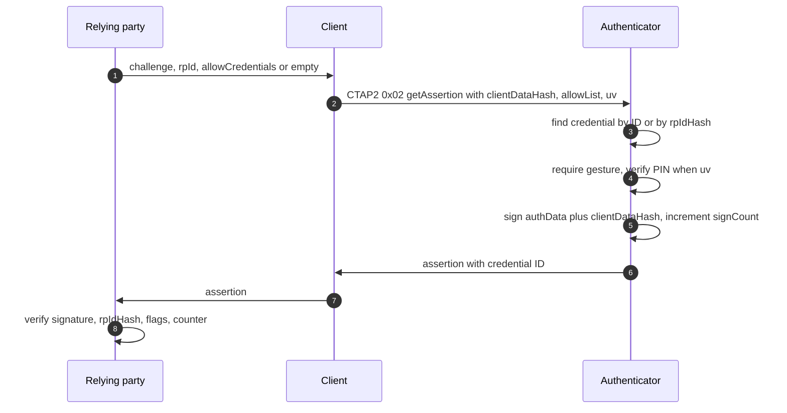
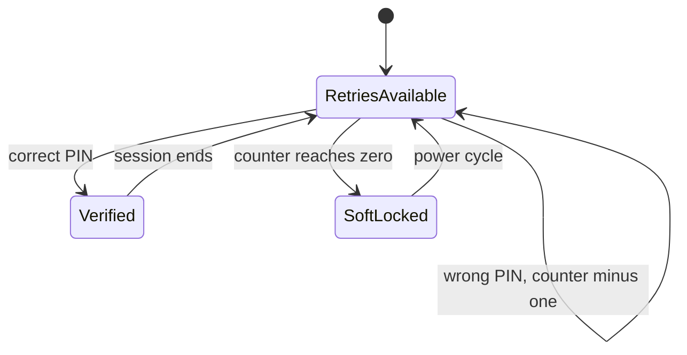

# 03 — FIDO2 and WebAuthn: the auth flows

Two ceremonies cold: registration and authentication. Sources: WebAuthn Level 3 (downloaded locally), plus the `pico-fido` implementation as the CTAP2 reference because the FIDO Alliance site returned 403 to automated fetches. Implementation citations name the file and line. Facts from the spec are `cited`; facts read out of `pico-fido` are `cited` as implementation behavior, which may exceed or lag the spec.

## The three parties

- **Relying party (RP)** — the website or service. It sets policy, generates challenges, and stores the public key or credential ID.
- **Client** — the browser or OS on the host. It mediates everything: it checks the RP's origin, hashes the ceremony data, and translates WebAuthn calls into CTAP2 messages over USB.
- **Authenticator** — your key. It generates keys, stores credentials, proves user presence or verification, and signs.

The RP and the authenticator never speak directly. The client sits between them with two different protocols: WebAuthn on the browser side, CTAP2 on the USB side (`cited` — WebAuthn L3 architecture; the client's dual role is why a bug in either side can break a ceremony).

## Registration ceremony

**What the RP sends** (`cited` — [WebAuthn L3 §5.1](https://www.w3.org/TR/webauthn-3/#sctn-createCredential)): `rp` (id and name), `user` (id, name, display name), `challenge`, `pubKeyCredParams` (acceptable algorithms), `timeout`, `excludeCredentials`, `authenticatorSelection` (attachment, resident-key requirement, user-verification requirement), `attestation` (none, indirect, direct, enterprise), `extensions`.

**What the client sends the key** — CTAP2 `authenticatorMakeCredential`, command byte `0x01` (`cited` — pico-fido `src/fido/ctap.h:104`). It carries `clientDataHash` (SHA-256 of the client's ceremony JSON, including the origin and challenge), `rp`, `user`, `pubKeyCredParams`, `excludeList`, and `options`. The implementation reads the resident-key and user-verification options out of that map and enforces policy with them (`cited` — `src/fido/cbor_make_credential.c:246,417-449`).

**What the key does**: matches `pubKeyCredParams` against supported algorithms, rejects if any credential in `excludeList` is already resident for that RP (`cited` — `cbor_make_credential.c:480-487`), requires a user gesture, performs user verification when requested, generates the keypair, builds the credential ID, stores it when `rk` is set, and assembles the response.

**What comes back** (`cited` — [WebAuthn L3 §6.1](https://www.w3.org/TR/webauthn-3/#sctn-authenticator-data)): authenticator data plus an attestation statement.

Authenticator data layout, byte for byte:

| Field | Size | Meaning |
| --- | --- | --- |
| `rpIdHash` | 32 | SHA-256 of the RP ID the credential is scoped to |
| `flags` | 1 | bit 0 UP, bit 2 UV, bit 3 BE (backup eligible), bit 6 AT (attested credential data included), bit 7 ED (extension data included) |
| `signCount` | 4 | 32-bit unsigned big-endian signature counter |
| attested credential data | variable | credential ID plus the credential public key |
| extensions | variable | extension-defined outputs |

A DIY key starts with no attestation or self-attestation; `pico-fido` emits `"packed"` (`cited` — `cbor_make_credential.c:816`).

## Authentication ceremony

**What the RP sends**: a fresh `challenge`, `rpId`, and either `allowCredentials` (the credential IDs it accepts) or nothing at all for a discoverable credential (`cited` — [WebAuthn L3 §5.1.3](https://www.w3.org/TR/webauthn-3/#sctn-getAssertion) examples show `allowCredentials` both populated and omitted).

**What the client sends the key** — CTAP2 `authenticatorGetAssertion`, command byte `0x02` (`cited` — `ctap.h:105`): `rpId`, `clientDataHash`, `allowList`, `extensions`, `options`, and optionally a PIN-UV auth parameter.

**What the key does**: looks the credential up by ID from `allowList`, or by `rpIdHash` when the RP offered no list (the discoverable case), requires a gesture, verifies the PIN when `uv` is requested, increments its sign counter, and signs `authenticatorData || clientDataHash` with the credential private key.

**What the server checks**: the signature against the stored public key, `rpIdHash` matches its own RP ID, required flags are set, and the counter did not move backwards (`cited` — WebAuthn L3 §6.1, §7.2). That counter is why a key that always returns zero, or a clone, gets flagged.

## CTAP2 command set

Command bytes as implemented (`cited` — `src/fido/ctap.h:104-113`):

| Byte | Command | Purpose |
| --- | --- | --- |
| `0x01` | `authenticatorMakeCredential` | registration |
| `0x02` | `authenticatorGetAssertion` | authentication |
| `0x04` | `authenticatorGetInfo` | capabilities discovery |
| `0x06` | `authenticatorClientPIN` | set/change/verify PIN, read retries |
| `0x07` | `authenticatorReset` | wipe all credentials |
| `0x08` | `authenticatorGetNextAssertion` | additional assertions after the first |
| `0x0A` | `authenticatorCredentialManagement` | enumerate and delete credentials |
| `0x0B` | `authenticatorSelection` | ask which credential to use |
| `0x0C` | `authenticatorLargeBlobs` | large-blob storage |
| `0x0D` | `authenticatorConfig` | vendor configuration subcommands |

`ClientPIN` subcommand `0x1` reports remaining PIN retries (`cited` — `cbor_client_pin.c:470-472`).

## GetInfo: what the key must advertise

The implementation reports a versions array (`U2F_V2` unless always-Uv, then `FIDO_2_0`, `FIDO_2_1`, `FIDO_2_2`, `FIDO_2_3`), an extensions array, an `aaguid`, and an options map with `rk`, `alwaysUv`, `credMgmt`, `authnrCfg`, `clientPin`, `largeBlobs`, `perCredMgmtRO`, `pinUvAuthToken`, and an enterprise flag when that profile is active (`cited` — `src/fido/cbor_get_info.c:95-145`).

Advertised extensions in that build: `uvm`, `credBlob`, `credProtect`, `hmac-secret`, `largeBlobKey`, `minPinLength`, `hmac-secret-mc`, `thirdPartyPayment`, plus `pinComplexityPolicy` when configured (`cited` — same file, lines 105-118).

## PIN and user verification

- Session state includes a lock flag and a power-cycle requirement; retry data is persisted to flash after PIN operations (`cited` — `cbor_client_pin.c:40-101`).
- A locked authenticator can require a physical power cycle before further PIN attempts (`cited` — `cbor_client_pin.c:100-101`, `pin_power_cycle_locked`).
- Optional PIN complexity policy enforces upper, lower, digit, and symbol classes (`cited` — `cbor_client_pin.c:357-389`).
- Practical mapping to a DIY key: PIN hash plus retry counter in flash, a lock state, and a documented unblock path. The spec-level PIN/UV auth protocol details remain to be read from a CTAP2 source once one is reachable.
- Concrete numbers in this build: eight PIN retries by default, the low seven bits of the PIN file store the counter, and the top bit marks a persistent soft-lock that needs a power cycle (`cited` — `src/fido/fido.h:94-98`, `cbor_client_pin.c:100-101,628-668`).

## Extensions worth choosing between

| Extension | Why you would want it |
| --- | --- |
| `credProtect` | Sets how much protection a credential requires (UV at registration, or always) |
| `hmac-secret` | Derives a stable per-credential secret — how a key becomes a second factor for encryption, not login |
| `credBlob` | Small per-credential data blob the RP stores on the key |
| `largeBlobs` | Larger storage, usually for `largeBlobKey` |
| `minPinLength` | Lets an enterprise force a PIN length |
| `uvm` | Reports which user-verification methods exist |

## CTAP1/U2F compatibility

Old sites still speak U2F, and `GetInfo` advertises `U2F_V2` unless always-Uv is enabled (`cited` — `cbor_get_info.c:95-100`). Supporting it means keeping the legacy register and authenticate commands alive alongside the CBOR ones. Decision for the MVP: cut it, or carry it from day one.

## Open questions

- Which algorithms to support at launch: ES256 only, or ES256 plus EdDSA.
- Resident-key storage budget on flash, and the eviction or full-storage behavior (`CTAP2_ERR_KEY_STORE_FULL` exists in `ctap.h:174`).
- Whether `alwaysUv` is ever enabled, and whether UV is PIN-only or also a second gesture.
- Which extensions ship in v1: `credProtect` and `hmac-secret` look high value, `thirdPartyPayment` and enterprise attestation look out of scope.
- Attestation stance: none versus self, and what the RP sees in `aaguid`.

## Sources

- [WebAuthn Level 3](https://www.w3.org/TR/webauthn-3/) §5.1 create, §5.1.3 get, §6.1 authenticator data, §6.5 attestation, §7.2 verifying an assertion.
- [pico-fido source code](https://github.com/polhenarejos/pico-fido), cloned locally: `src/fido/ctap.h` (command bytes, error codes), `src/fido/cbor_get_info.c` (versions, extensions, options), `src/fido/cbor_make_credential.c` (exclude list, options, packed attestation), `src/fido/cbor_client_pin.c` (retries, lockout, complexity), `src/fido/cbor_get_assertion.c`.
- [polhenarejos/pico-fido](https://github.com/polhenarejos/pico-fido) README — feature list, conformance notes.
- Blocked: FIDO Alliance spec site returned 403 to every automated fetch attempt, so CTAP2 spec section numbers are still unverified. Retry later or find a mirror before quoting spec text.
