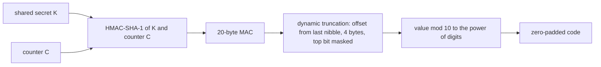
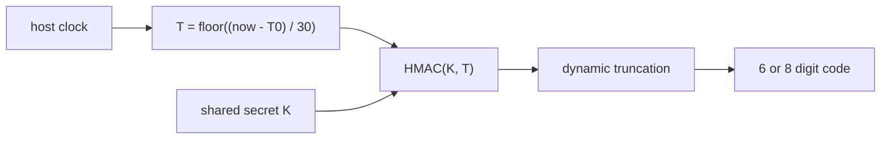
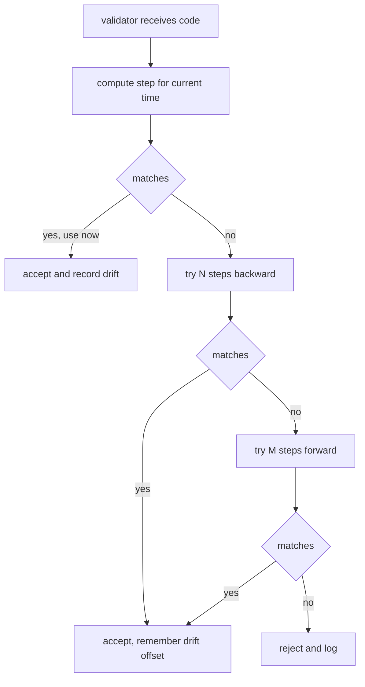
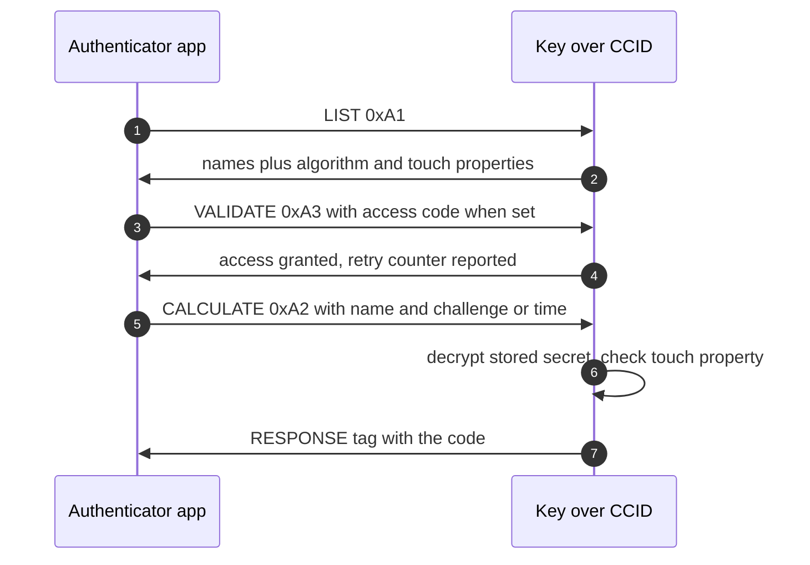
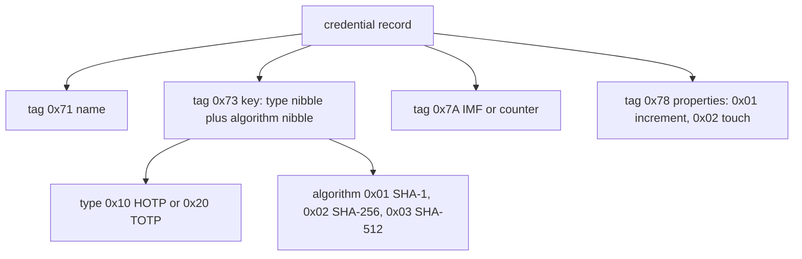
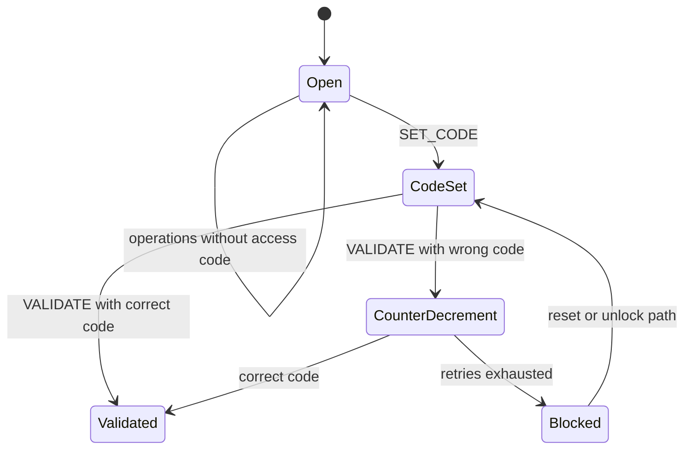

# 04 — OATH: TOTP and HOTP

One-time passwords as a key feature: the mechanism, the two variants, the on-key protocol, and the failure modes. Sources: RFC 4226 (HOTP), RFC 6238 (TOTP), both downloaded locally, plus the `pico-fido` OATH implementation as the practical reference for what a key actually stores and speaks.

## The core idea

Both variants are the same computation with a different moving factor.

- **HOTP** (RFC 4226): `HOTP(K, C) = Truncate(HMAC-SHA-1(K, C))`, where `K` is a shared secret and `C` is an incrementing counter (`cited` — [RFC 4226 §5.1](https://datatracker.ietf.org/doc/html/rfc4226#section-5)).
- **TOTP** (RFC 6238): HOTP with `C` replaced by a time step: `T = floor((now - T0) / X)`, `X` default 30 seconds, `T0` default 0, the Unix epoch (`cited` — [RFC 6238 §4.1](https://datatracker.ietf.org/doc/html/rfc6238#section-4.1)).
- The shared secret must be strong: at least 128 bits, with 160 bits recommended (`cited` — RFC 4226 §7.2 rule R6).

The truncation is the part that turns a 20-byte MAC into six digits: take the low four bits of the last MAC byte as an offset, read four bytes from there, mask the top bit, convert to a number, then take it modulo `10^Digit` (`cited` — RFC 4226 §5.2, §5.3).

## Worked test vector, HOTP

Secret is the ASCII string `12345678901234567890`, which is `0x3132333435363738393031323334353637383930` (`cited` — RFC 4226 Appendix D):

| Counter | HMAC-SHA-1 (hex) | HOTP |
| --- | --- | --- |
| 0 | `cc93cf18508d94934c64b65d8ba7667fb7cde4b0` | 755224 |
| 1 | `75a48a19d4cbe100644e8ac1397eea747a2d33ab` | 287082 |

Hands-on check: recompute counter 0 with `python3 -c` and HMAC-SHA1, apply the truncation by hand, and confirm you land on `755224`. If you do not, the truncation offset is the usual suspect.

## TOTP vectors

Same secret, `X = 30`, `T0 = 0` (`cited` — RFC 6238 Appendix B):

| Unix time | Time step T (hex) | TOTP (SHA-1) |
| --- | --- | --- |
| 59 | `0000000000000001` | 94287082 |
| 1111111109 | `00000000023523EC` | 07081804 |
| 1111111111 | `00000000023523ED` | 14050471 |
| 1234567890 | `000000000273EF07` | 89005924 |
| 2000000000 | `0000000003F940AA` | 69279037 |

## Clock drift and counter drift

- **TOTP side**: the validator should accept a bounded number of steps forward and backward. RFC 6238's own example: with a 30-second step and acceptance of two steps backward, the tolerated drift is about 89 seconds, which means up to three validations per received code (`cited` — RFC 6238 §6).
- **HOTP side**: the counter can desynchronize, so RFC 4226 specifies a resynchronization mechanism, including a counter-based method in Appendix E.4 (`cited` — RFC 4226 §7.4).
- Practical asymmetry: TOTP drift is fixed by widening the window or correcting the clock; HOTP drift is fixed by advancing the token's counter, which is a state change and therefore riskier.

## What a key actually does: YKOATH

The Yubico OATH protocol is the de facto interface for on-key OTP credentials, and `pico-fido` implements it over its smartcard (CCID) transport, which is why tools such as Yubico Authenticator work against it (`cited` — project README, and `src/fido/oath.c` where responses are sized against the CCID header).

Instruction set as implemented (`cited` — `src/fido/oath.c:1596-1610`):

| Instruction | Byte | Purpose |
| --- | --- | --- |
| `PUT` | `0x01` | store or overwrite a credential |
| `DELETE` | `0x02` | remove one credential |
| `SET_CODE` | `0x03` | set the OATH access code |
| `RESET` | `0x04` | wipe OATH state |
| `RENAME` | `0x05` | rename a credential |
| `LIST` | `0xA1` | enumerate credentials and properties |
| `CALCULATE` | `0xA2` | compute one code |
| `VALIDATE` | `0xA3` | authenticate with the access code |
| `CALC_ALL` | `0xA4` | compute all codes, streamed |
| `SEND_REMAINING` | `0xA5` | continue a streamed response |
| `VERIFY_CODE` | `0xB1` | verify access code |
| `VERIFY_PIN`, `CHANGE_PIN`, `SET_PIN` | `0xB2`–`0xB4` | PIN handling |
| `GET_CREDENTIAL` | `0xB5` | read one credential record |

Credential records are TLV and carry everything the computation needs (`cited` — `src/fido/oath.c:48-78`):

Behavior worth knowing from the implementation:

- Stored secrets are encrypted at rest and decrypted only for the computation; the plaintext buffer is zeroized afterwards (`cited` — `oath.c:1052-1122`).
- For **HOTP**, the key reads the stored counter, computes with it, then writes back counter plus one before returning the code (`cited` — `oath.c:1085-1113`). That write is why HOTP consumes flash on every code.
- For **TOTP**, the host supplies the time-derived value; the key stores no clock (`cited` — same block, where the challenge only comes from the record for HOTP).
- A credential can require a physical touch (`PROP_TOUCH`), enforced with a user-presence check that fails the operation when the button was not pressed (`cited` — `oath.c:77-78, 1064-1068`).
- Capacity is capped at 255 credentials (`cited` — `oath.c:35`).

## Access code and PIN state

The OATH state is not wide open by default: an access code (`TAG_PASSWORD 0x80`) gates credential access, validated by `VERIFY_CODE 0xB1`, with a retry counter reported through `TAG_PIN_COUNTER 0x82` (`cited` — `oath.c:48-66, 1596-1610`).

## Yubico OTP is a different feature

The same firmware also implements Yubico OTP with keyboard emulation: a slot holds fixed data and a secret, the device types the generated code as a USB keyboard, and configuration is bounded by bump tries (`cited` — `src/fido/otp.c:33-137, 480-565`). It shares the "one-time password" label with OATH but not the protocol or the credential format. Keep it out of the MVP unless the keyboard interface is wanted for its own sake.

## Decisions to make

- Which algorithms ship: SHA-1 only for maximum compatibility, or SHA-1 plus SHA-256 (the implementation already supports SHA-1, SHA-256, and SHA-512).
- Digits: 6 only, or 6 and 8.
- Period: 30 seconds only, or also 60.
- Touch policy: default per credential, per device, or off.
- Where time comes from for TOTP: host-supplied (simple, no RTC, no battery) versus on-device clock.
- HOTP counter writes: how to reduce flash wear, and how to behave when a write fails mid-operation.
- Access code: required by default or optional.

## Open questions

- Whether credential secrets should be wrapped under a device master key derived from the PIN or access code, and what a forgotten PIN costs the user.
- How CALC_ALL streaming behaves when a credential requires touch.
- Whether the OATH app should live on the CCID interface only, or also be reachable over CTAP vendor commands.

## Sources

- [RFC 4226](https://datatracker.ietf.org/doc/html/rfc4226) §5.1–5.3 algorithm and truncation, §7.2 R6 secret strength, §7.4 resynchronization, Appendix D test values, Appendix E.4 counter-based resync.
- [RFC 6238](https://datatracker.ietf.org/doc/html/rfc6238) §4.1 time step and T0, §6 resynchronization and drift limits, Appendix B test vectors.
- [pico-fido source code](https://github.com/polhenarejos/pico-fido), cloned locally: `src/fido/oath.c` (instruction set, TLV tags, limits, HOTP counter write-back, touch enforcement, encrypted key handling), `src/fido/oath_container.c` and `oath_container.h` (record storage), `src/fido/otp.c` (Yubico OTP and keyboard emulation).
