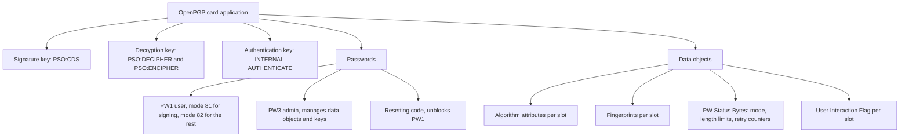
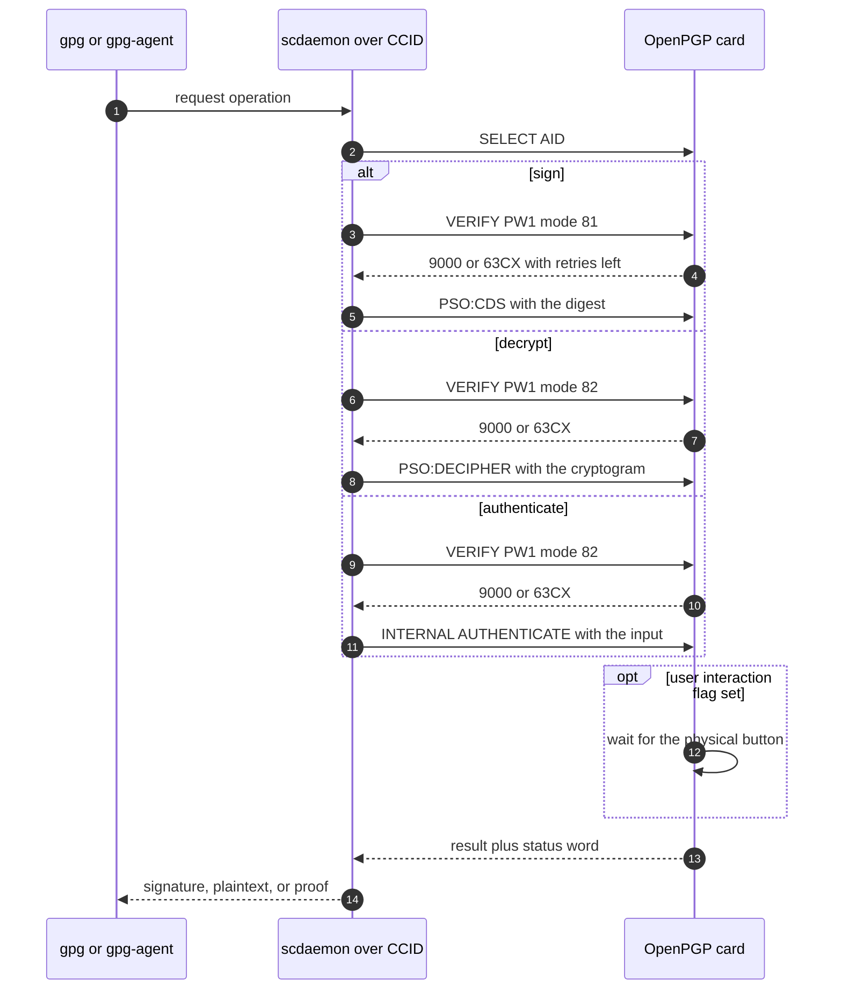
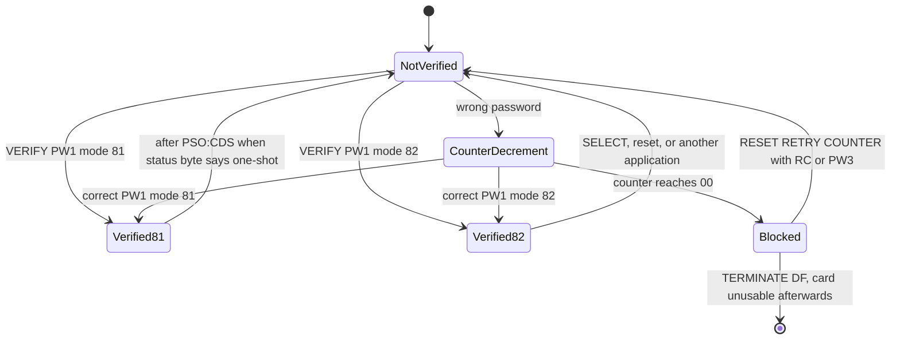
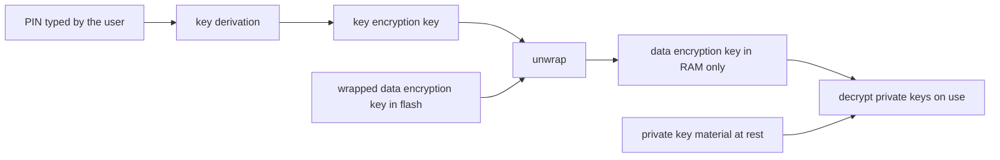
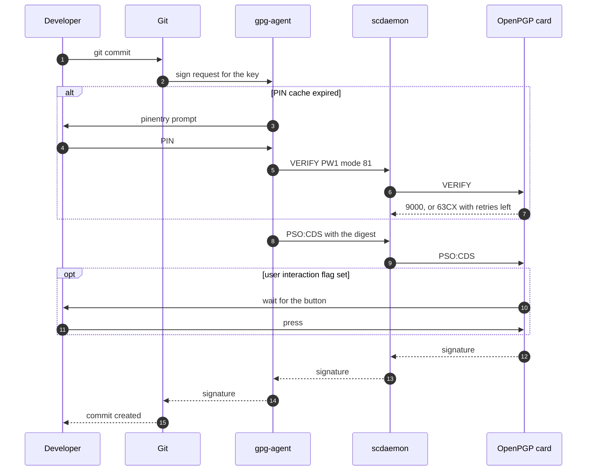
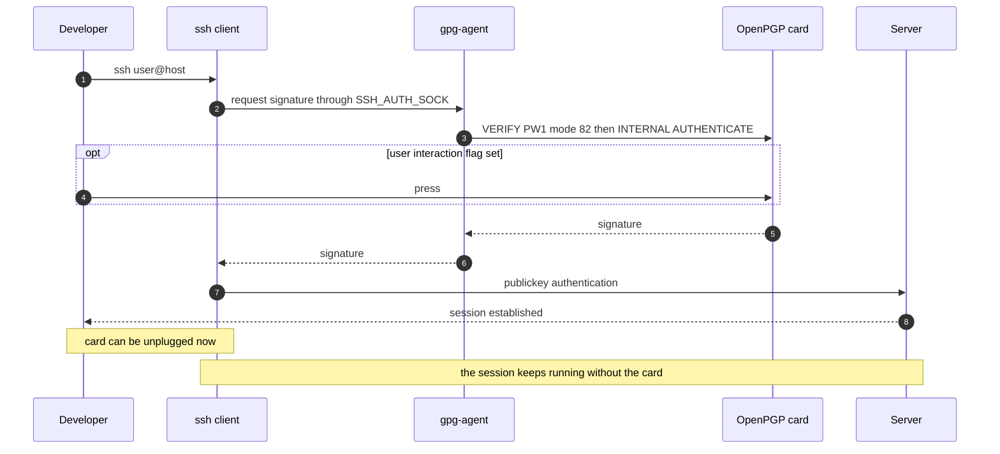
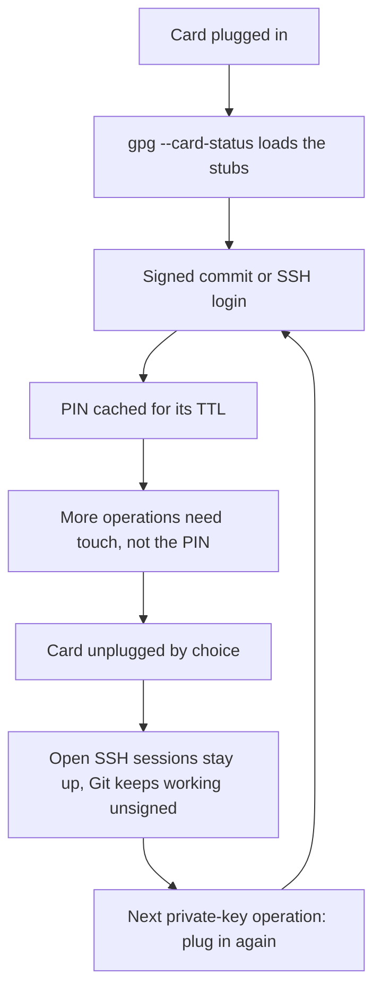

# 05 — OpenPGP card: sign, decrypt, authenticate

The smartcard model behind `gpg`. Sources: the OpenPGP card functional specification 3.4.1 (downloaded locally), the GnuPG manual, Yubico's PGP documentation, and the `pico-openpgp` implementation as the practical reference for what a DIY card must actually store and enforce.

## Standard versus implementation

Three different things share the name "OpenPGP", and mixing them up causes bad design decisions:

| Thing | What it is | Who owns it |
| --- | --- | --- |
| OpenPGP message format | The standard for keys, certificates, and encrypted or signed messages: [RFC 9580](https://datatracker.ietf.org/doc/html/rfc9580) (it replaced RFC 4880) | IETF |
| OpenPGP card application | The smartcard-side specification: files, data objects, passwords, and APDU commands. Version 3.4.1 is the reference here | Achim Pietig's functional specification, not an IETF RFC |
| GnuPG (`gpg`, `gpg-agent`, `scdaemon`) | The implementation that talks to cards and produces or verifies OpenPGP messages | GnuPG project |

Consequence for this project: "supports OpenPGP" means the card application first, message-level compatibility second. GnuPG is the host tool that will judge whether the card works.

## Card anatomy

The application is selected by a 16-byte AID whose RID is registered by FSF Europe / GnuPG (`cited` — spec §4.2.1).

Three private key slots exist, each tied to one operation (`cited` — spec §4.4.3.8 and the key information section: the application supports three private keys for COMPUTE DIGITAL SIGNATURE, ENCIPHER/DECIPHER, and INTERNAL AUTHENTICATE):

## The three operations

| Operation | Command | Key used | Password required |
| --- | --- | --- | --- |
| Sign | `PSO: COMPUTE DIGITAL SIGNATURE` (`PSO:CDS`) | Signature key | PW1 with No. 81, valid for one or several signatures depending on the status byte |
| Decrypt | `PSO: DECIPHER` | Decryption key | PW1 with No. 82 |
| Authenticate | `INTERNAL AUTHENTICATE` | Authentication key | PW1 with No. 82 |

Sources: `cited` — spec §7.2.10, §7.2.11 ("can be used after correct presentation of PW1 with No. 82 only"), §7.2.13 (same requirement), §7.2.2 on PW1 modes.

## Touch is in the specification

A common belief is that button confirmation on OpenPGP smartcards is a vendor extra. Not quite: the spec defines a **User Interaction Flag** per slot. When it is enabled and a button or keypad exists, the related function runs only after the user presses it — explicitly as a defense against viruses and trojans that try to use the card without the owner's knowledge. If the user aborts or the wait times out, the card should answer with `6600` (`cited` — spec §4.4.3.6).

Vendor tools add policy knobs on top of that flag: Yubico's documentation exposes touch policy settings per key and the corresponding `ykman` commands (`cited` — Yubico PGP documentation, reachable). The spec guarantee is the flag and the abort behavior, not a three-state policy.

## Passwords and retry counters

- PW1 has two modes: No. 81 gates `PSO:CDS` only and is either one-shot or valid for several signatures depending on status byte 1; No. 82 gates the other operations and stays valid until reset or another application is selected (`cited` — spec §7.2.2, and the PW Status Bytes table).
- `VERIFY` with empty data returns the current access status; when verification is required the card answers `63CX` where X is the number of remaining retries (`cited` — spec §7.2.2).
- `VERIFY` with `P1 = FF` resets the addressed password to "not verified" (`cited` — spec §7.2.2).
- The **PW Status Bytes** data object (C4) carries the mode byte, the maximum lengths for PW1, the resetting code, PW3, and the three error counters for PW1, RC, and PW3. Counter `00` means blocked, and a correct verification restores the default value **03** (`cited` — spec DO table, C4).
- `RESET RETRY COUNTER` resets the retry counter of PW1, either with PW3 or with the resetting code — the reason a resetting code exists at all (`cited` — spec §7.2.4, §4.3.4).
- `TERMINATE DF` is the nuclear option and stays usable when PW3 itself is blocked, under stated conditions (`cited` — spec §7.2.16).

## What actually lives in flash, per the implementation

`pico-openpgp` shows one honest way to arrange storage. Its internal file identifiers are not spec data-object numbers, they are the card's own layout:

| Internal file | ID | Role |
| --- | --- | --- |
| `EF_PW1`, `EF_RC`, `EF_PW3` | `0x1081`, `0x1082`, `0x1083` | password records |
| `EF_ALGO_PRIV1..3` | `0x10C1`–`0x10C3` | algorithm attributes per slot |
| `EF_PW_RETRIES` | `0x10C5` | retry counter storage |
| `EF_PK_SIG`, `EF_PK_DEC`, `EF_PK_AUT` | `0x10D1`–`0x10D3` | the three protected private keys |
| `EF_DEK`, `EF_DEK_PW1`, `EF_DEK_RC`, `EF_DEK_PW3` | `0x1099`–`0x109C` | data encryption key and its per-password wrapped copies |

(`cited` — `pico-openpgp/src/openpgp/files.h:24-42`.)

The wrapping model is the important part. The private keys are not decrypted with the PIN directly; the PIN unwraps a **data encryption key**, and that key decrypts the private keys. Changing a PIN re-wraps the data encryption key rather than re-encrypting the key material, which is also why a lost PIN does not have to mean a lost key as long as an administrative path exists (`cited` — `cmd_verify.c:84-88` for retry reporting, `cmd_change_pin.c:103,136` and `cmd_reset_retry.c:80` for re-wrapping).

Supported algorithms in that build: RSA, ECDSA, ECDH, EdDSA, plus AES variants (`cited` — `src/openpgp/openpgp.h:57-64`). Button enforcement is wired into the PSO path through a user-interaction flag file lookup plus a button wait (`cited` — `src/openpgp/cmd_pso.c:35-123`).

## Key lifecycle

- **Generate on card**: `GENERATE ASYMMETRIC KEY PAIR`, with the private key never leaving the device (`cited` — spec §7.2.14).
- **Import**: same command with the extended header list, which is how a key generated elsewhere is loaded — and therefore the riskiest path, because the key existed outside the card (`cited` — spec §7.2.14, the extended header and private key template objects).
- **Terminate**: `TERMINATE DF` to decommission, `ACTIVATE FILE` for lifecycle management (`cited` — spec §7.2.16, §7.2.17).

## What the host will actually exercise

- `gpg --card-status` reads the application-related data and shows slot state and fingerprints (`cited` — GnuPG manual).
- Signing a file or a Git commit, decrypting a message, and SSH login through `gpg-agent` are the three real-world tests (`inferred` from standard GnuPG usage, and the reason the three slots exist).
- Failure paths worth testing deliberately: wrong PIN three times, PW1 blocked, unblock with resetting code, blocked PW3, `TERMINATE DF`, and signing with the user interaction flag enabled but no button press.

## Day-to-day workflows

Two workflows matter in practice: signing Git commits and logging in over SSH. Both follow the same shape. The host holds only a public stub, the card holds the private key, and the card is needed only while a private-key operation runs.

### One-time setup on the host

- Plug the card in and confirm the host sees it: `gpg --card-status` (`cited` — GnuPG manual, card commands).
- For Git, point the signing key at the card's key and turn signing on: `git config --global user.signingkey <KEYID>` and `git config --global commit.gpgsign true` (`cited` — Git documentation).
- For SSH, enable the agent's SSH emulation in `~/.gnupg/gpg-agent.conf` with `enable-ssh-support`, then in the shell point `SSH_AUTH_SOCK` at the agent's SSH socket and drop the old variable (`cited` — `gpg-agent(1)`: `export SSH_AUTH_SOCK="$(gpgconf --list-dirs agent-ssh-socket)"` and `unset SSH_AGENT_PID`).
- Export the public key with `ssh-add -L` and paste it into the target server's `~/.ssh/authorized_keys`. Yubico describes the same arrangement: the OpenPGP authentication subkey is used as the SSH key (`cited` — Yubico PGP SSH authentication page).

### Signing a commit

The chain is Git to `gpg` to `gpg-agent` to `scdaemon` to the card. Each link is a program on the host until the last one.

Practical consequences:

- The card must be attached while the commit is signed, and can be detached immediately after. A later signed commit needs it again.
- An unsigned commit needs nothing, so `commit.gpgsign true` is a per-repo or per-user choice, not a global obligation.
- The PIN is cached, not the signature. Defaults are 600 seconds for general cache entries and 1800 seconds for SSH keys, each refreshed on use until `max-cache-ttl` is reached (`cited` — `gpg-agent(1)`, `--default-cache-ttl`, `--default-cache-ttl-ssh`, `--max-cache-ttl`).
- The button, when the user interaction flag is enabled, is still required for every single operation. Caching never replaces touch (`cited` — spec §4.4.3.6).

### Logging in over SSH

There is no private key file to point at, so `ssh -i /path/to/hardware` is not a thing. The agent is the mechanism; `-i` can only select which identity to offer (`cited` — `ssh_config(5)` says agent identities are used unless `IdentitiesOnly` is set).

Practical consequences:

- The card is needed at connection start only, because authentication happens once. After that the session survives a detached card.
- Every new connection repeats the card step, including the button press.
- For many connections, `ControlMaster` with `ControlPersist` reuses one authenticated connection, and agent forwarding covers hopping through a host.

### Attach and detach over one working session

What survives detaching: open SSH sessions, the host keyring stubs, and the PIN cache until it expires. What does not survive: a new signature. Signing is a card operation every time.

### State of this machine

Measured during note 04 and 05 work: `gpg` 2.2.27, `ssh` 8.9p1, and `git` 2.55.0 are installed. `scdaemon` is **not** present, there is no `~/.gnupg/gpg-agent.conf`, and neither `commit.gpgsign` nor `user.signingkey` is set. Smartcard support therefore needs installing before any of the workflows above can run (`measured`), and the missing pieces are a host-setup item for a later phase (`inferred`).

## Decisions to make

- Which algorithms to advertise in the algorithm attribute data objects: ECDSA plus EdDSA plus ECDH, with RSA only if a host requires it.
- Whether on-card generation stays the only supported path initially, with import deferred behind an explicit decision.
- PW1 mode: one-shot signing or multiple signatures per verification.
- Retry counter default and whether the resetting code is enabled at all.
- User interaction flag defaults per slot, and what the button timeout is.
- Whether to implement `PSO:ENCIPHER` (needed for some legacy schemes) or only `PSO:DECIPHER`.

## Open questions

- Exact AID bytes and whether the card also needs to expose a PIV application, as `pico-openpgp` does (`src/piv`).
- Whether secure messaging is in scope; the spec defines it, host support is uneven.
- How fingerprints are computed and stored for imported keys, and what happens on a mismatch.
- What `--card-status` must report so GnuPG is satisfied with a keyless slot.

## Sources

- [OpenPGP card functional specification 3.4.1](https://gnupg.org/ftp/specs/OpenPGP-smart-card-application-3.4.1.pdf) — §4.2.1 AID, §4.3 user verification, §4.4.3.6 User Interaction Flag, §4.4.3.8 Key Information, DO tables (C4 status bytes, C1–C3 attributes, C5 and later fingerprints), §7.2.2 VERIFY, §7.2.4 RESET RETRY COUNTER, §7.2.10–§7.2.13 PSO and INTERNAL AUTHENTICATE, §7.2.14 key generation and import, §7.2.16 TERMINATE DF.
- [GnuPG manual, gpg(1)](https://www.gnupg.org/documentation/manuals/gnupg24/gpg.1.html) — card commands and `--card-status`. The older `Card-Commands.html` page now returns 404.
- `gpg-agent(1)` and `ssh_config(5)` man pages, read locally on this machine — SSH emulation, `SSH_AUTH_SOCK`, cache TTLs, identity selection.
- [Yubico PGP documentation](https://developers.yubico.com/PGP/) — touch policy configuration and practical card editing.
- [pico-openpgp source code](https://github.com/polhenarejos/pico-openpgp), cloned locally: `src/openpgp/files.h` (storage layout), `cmd_verify.c` and `cmd_pso.c` (retry reporting, button enforcement), `cmd_change_pin.c` and `cmd_reset_retry.c` (re-wrapping), `openpgp.h` (algorithm identifiers), `src/piv` (parallel PIV application).
- [RFC 9580](https://datatracker.ietf.org/doc/html/rfc9580) — OpenPGP message format, the standard GnuPG implements.
