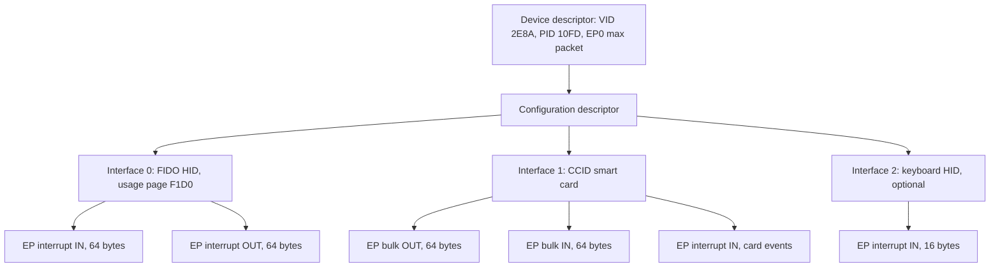
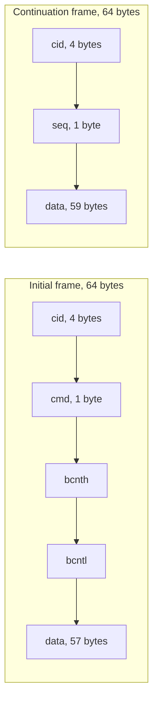
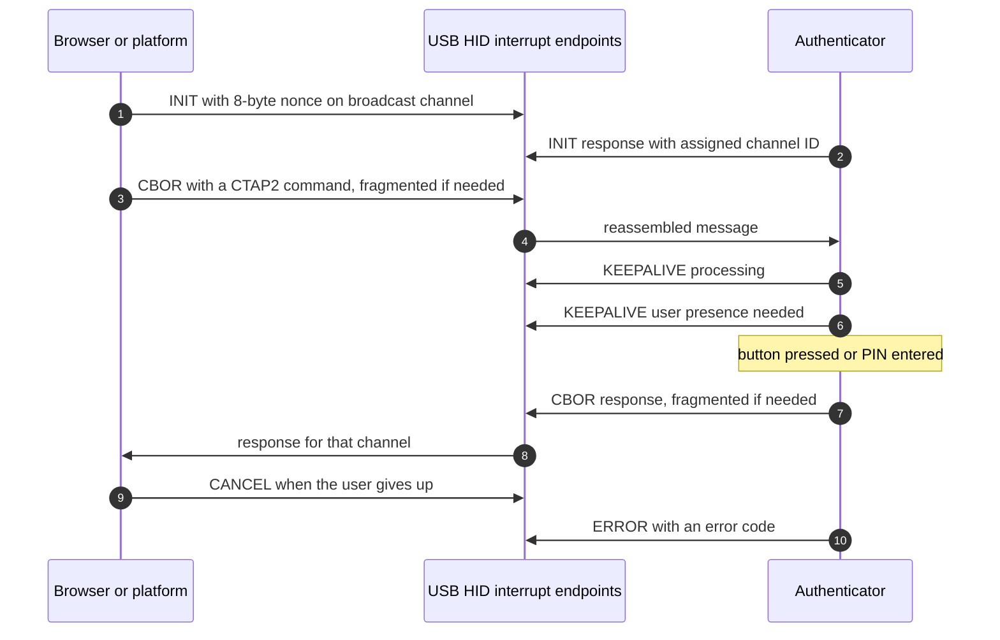
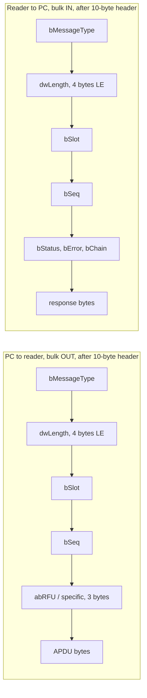
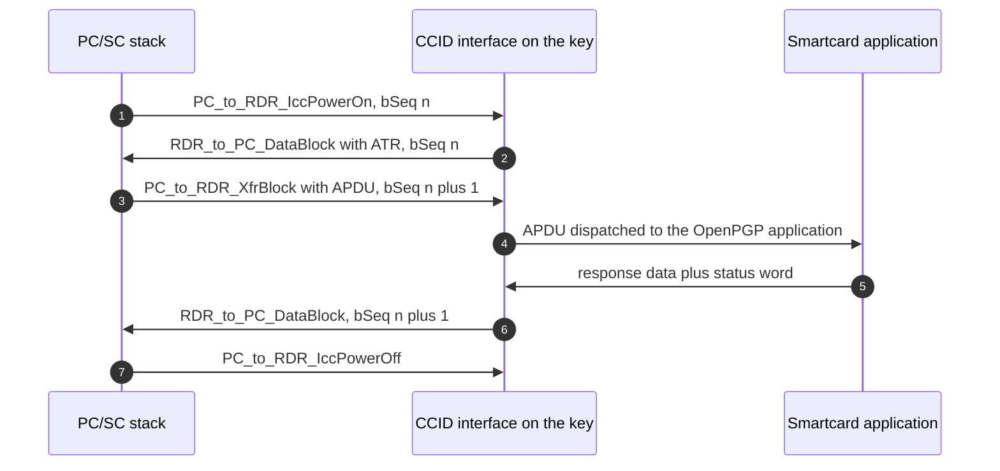
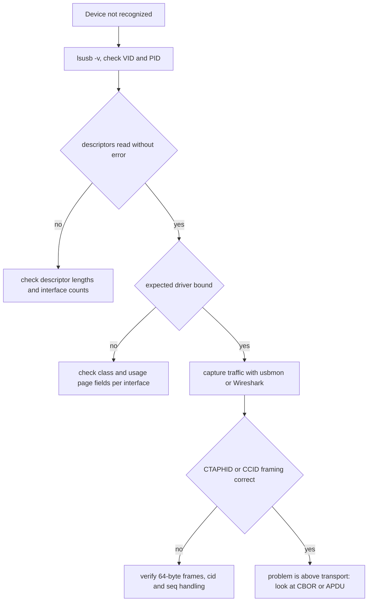

# 06 — USB transport: how the key speaks

The layer between "the browser wants a passkey" and "the chip does crypto". Sources: RP2350 datasheet §12.7 for the controller, the CCID specification Rev 1.1 for the smartcard transport, WebAuthn for what the host expects, and the `pico-keys-sdk` USB stack as the implementation reference for a real composite device.

## The device model in one pass

A USB device is not "a device that does things". It is a set of **descriptors** the host reads at enumeration, plus **endpoints** the host then talks to. Get the descriptors wrong and nothing else matters, because the host never gets far enough to run your code.

- **Device descriptor** — vendor ID, product ID, USB version, max packet size for endpoint 0.
- **Configuration descriptor** — how many interfaces, how much power the device wants.
- **Interface descriptor** — one function: the class decides which host driver binds (HID, CCID, CDC, vendor-specific).
- **Endpoint descriptor** — a numbered, one-way pipe with a transfer type and a max packet size.

Transfer types, and what they are for:

| Type | Property | Typical use on a key |
| --- | --- | --- |
| Control | Bidirectional, structured requests, always endpoint 0 | enumeration, class requests, `SET_REPORT` on some hosts, CCID abort |
| Interrupt | Small, polled at a guaranteed interval, latency-bounded | FIDO HID reports, keyboard reports, card-insertion notifications |
| Bulk | Large, no timing guarantee, retried by hardware | CCID APDU exchange |
| Isochronous | Timing guarantee, no retry | audio or video, not relevant here |

At full speed (USB 1.1), bulk and interrupt endpoints have a 64-byte maximum packet size, which is why every protocol in this note is built around 64-byte messages.

## The RP2350 USB controller

`cited` — RP2350 datasheet §12.7:

- Up to 32 endpoints, endpoints 0 through 15 in both directions.
- Control, isochronous, bulk, and interrupt endpoint types, with double buffering.
- 3840 bytes of usable buffer space in DPSRAM, equal to 60 buffers of 64 bytes.
- The DPSRAM window is 4 kB at `0x50100000` (`USBCTRL_DPRAM_BASE`); unused space can hold user data, and all 4 kB is available when the controller is disabled.
- The controller supports both device and host roles; a key uses device mode only.

Practical reading: endpoint count is not the constraint. Sixty 64-byte buffers and the host's class-driver expectations are.

## What a real composite key exposes

`pico-keys-sdk` builds one configuration containing several interfaces (`cited` — `src/usb/usb_descriptors.c`):

| Interface | Class | Endpoints | Packet size |
| --- | --- | --- | --- |
| FIDO | HID, usage page `0xF1D0` usage `0x01` | interrupt IN plus interrupt OUT | 64 bytes |
| CCID | Smart card | bulk OUT, bulk IN, interrupt IN | 64 bytes |
| Keyboard (optional) | HID, boot-compatible keyboard | interrupt IN | 16 bytes |
| WCID and lwIP (optional) | vendor class, CDC-NCM | vendor defined | build dependent |

Vendor and product IDs default to `0x2E8A` and `0x10FD` (`cited` — same file, lines 27-31), and each interface is gated by a build flag, so a minimal key can ship with just the HID interface.

Counting endpoint 0: seven endpoints in this layout, well inside the controller's 32. The reasons to stay small are host-side: every extra interface is another driver binding, another chance for a composite-device quirk, and another 64-byte double buffer to keep straight.

## CTAPHID: how FIDO2 rides on HID

FIDO2 does not use a custom class. It uses HID reports of 64 bytes and a framing layer called CTAPHID, so that no driver install is needed anywhere. (`cited` — `pico-keys-sdk/src/usb/hid/ctap_hid.h`.)

- Report size is 64 bytes (`HID_RPT_SIZE`, line 35).
- The FIDO usage page is `0xF1D0`, and the top-level collection usage is `0x01` (lines 72-73).
- Every message starts with a 4-byte **channel ID**. `0xFFFFFFFF` is the broadcast channel used only for initialization (line 39).
- The first byte of the header area also encodes the **frame type**: bit 7 set means initial frame, clear means continuation frame (`TYPE_MASK`, `TYPE_INIT`, `TYPE_CONT`, lines 41-43).

Frame layouts, byte for byte (lines 46-61):

- `bcnth * 256 + bcntl` is the total message length, and the `init` and `cont` union members are how the stack reads it (line 67).
- Commands in use include `PING 0x01`, `MSG 0x03`, `LOCK 0x04`, `INIT 0x06`, `WINK 0x08`, `CBOR 0x10`, `CANCEL 0x11`, `KEEPALIVE 0x3B`, `SYNC 0x3C`, and `ERROR 0x3F` (lines 84-93). Everything with bit 7 set is an initial frame carrying a command.
- Interface version is 2, the default transaction timeout is 3000 ms, and the initialization challenge nonce is 8 bytes (lines 79-80, 115).
- `KEEPALIVE` exists because a user may need to touch the key or type a PIN: status `0x1` means processing, `0x2` means user presence is needed (lines 110-111). This is how the browser shows "touch your security key" without the transaction timing out.

Two implementation traps worth knowing now: a channel can be abandoned mid-message, so the reassembly buffer needs a timeout; and the transport has no authentication of its own — the CBOR payload's PIN or UV is what proves the user, not the channel.

## CCID: how smartcard bytes ride on USB

CCID is the standard class for card readers and smartcards on USB. It exists so that a host's existing PC/SC stack can talk to a card without knowing anything about the vendor. (`cited` — CCID specification Rev 1.1.)

- A CCID must support at least two endpoints beyond control: one bulk OUT and one bulk IN. A card that reports insertion or removal events must also expose an **interrupt endpoint** for those notifications (spec, endpoint configuration section).
- Every message begins with a 10-byte header: `bMessageType`, `dwLength` (little-endian, 4 bytes, length **excluding** the header), `bSlot`, `bSeq`, then message-specific bytes (spec §6 header description).
- `bSeq` is a monotonically increasing counter for bulk messages sent to the CCID; the response must carry the same value, which is how the driver matches responses to commands (spec §6 header description and the slot-state discussion).
- `PC_to_RDR_XfrBlock` (`0x6F`) carries the APDU, and its block must not exceed `dwMaxCCIDMessageLength - 10` (spec §6.1.4).
- Extended APDU support is advertised in `dwMaxCCIDMessageLength`, where the valid range depends on the APDU level the device claims (spec, functional descriptor).

Message types the implementation handles (`cited` — `pico-keys-sdk/src/usb/ccid/ccid.c:40-58`): `SET_PARAMS 0x61`, `POWER_ON 0x62`, `POWER_OFF 0x63`, `SLOT_STATUS 0x65`, `SECURE 0x69`, `GET_PARAMS 0x6C`, `RESET_PARAMS 0x6D`, `XFR_BLOCK 0x6F`, plus responses `DATA_BLOCK 0x80`, `SLOT_STATUS 0x81`, `PARAMS 0x82`, and `0x84` for the data-rate command. Status and error codes live in offsets 6 through 9 of the header (`ccid.c:54-58`), and the APDU payload starts at offset 10 (`ccid.c:58`, matching the spec's 10-byte header).

Note the layering: the APDU is opaque to CCID. Everything specific to OpenPGP or OATH lives above this transport, which is why the same USB interface can serve both applications in one key.

## Composite device reality

- The three interfaces coexist in one configuration. Each carries its own interface number and its own endpoint numbers; the host binds a different driver per class.
- Windows, macOS, and Linux all enumerate composite devices, but the classes matter for driver availability. HID needs nothing. CCID is served by the platform's smartcard stack, which on Linux is PC/SC through `ccid` and on Windows is the smart card class driver. Slots and `bSeq` behavior are what those drivers test.
- The RP2350 bootloader (BOOTSEL) enumerates as a mass-storage device with different identifiers, so after flashing, the host sees the device disappear and reappear with a new VID and PID set — normal, but it means the kernel rebinds drivers mid-session (`inferred` from the boot-mode behavior described in the datasheet's boot chapter).
- Endpoint budget is not the problem at three interfaces; flash and RAM are. Each interface's stack code, its buffers, and its descriptors all come out of the same 520 KB SRAM.

## Debug checklist for this project

Tools: `lsusb -v` for descriptors, `usbmon` plus Wireshark for packets, kernel logs for enumeration errors, and the browser's WebAuthn diagnostics plus `gpg --card-status` as end-to-end tests.

## Decisions to make

- Which interfaces ship in the first firmware: HID only is the smallest honest step; CCID follows when OpenPGP work starts.
- Whether keyboard emulation (Yubico OTP) is ever enabled, given it adds a third interface with its own HID report descriptor.
- Endpoint packaging: separate IN and OUT interrupt endpoints for HID as the reference does, or IN only with `SET_REPORT` control transfers.
- Keepalive policy during a user-presence wait, and the timeout the browser will tolerate.
- Whether to advertise extended APDU sizes in `dwMaxCCIDMessageLength` or stay at short APDUs initially.

## Open questions

- Whether to keep the WCID and lwIP interfaces compiled out permanently, and what that does to any vendor tooling.
- How the host behaves if enumeration happens while the device still holds credentials from an interrupted ceremony.
- Whether the firmware should offer a separate debug interface that is never present in a release image.
- What the minimum viable descriptor set looks like for the browser to accept the key on all target hosts (`tested` only after real hardware tests).

## Sources

- RP2350 datasheet §12.7 — endpoint count, endpoint types, double buffering, DPSRAM size and base address, device and host roles.
- [CCID specification Rev 1.1](https://www.usb.org/sites/default/files/DWG_Smart-Card_CCID_Rev110.pdf) — header layout, message types, `bSeq` correlation, endpoint requirements, `dwMaxCCIDMessageLength`, slot busy handling.
- [WebAuthn Level 3](https://www.w3.org/TR/webauthn-3/) — what the client expects from an authenticator over HID.
- [pico-keys-sdk source code](https://github.com/polhenarejos/pico-keys-sdk), cloned locally: `src/usb/hid/ctap_hid.h` (frame layouts, report size, channel IDs, command codes, keepalive statuses, timeouts), `src/usb/usb_descriptors.c` (VID, PID, interface and endpoint layout, packet sizes), `src/usb/ccid/ccid.c` and `ccid.h` (CCID message types, header offsets, buffer sizes).
- [USB in a Nutshell](https://www.beyondlogic.org/usbnutshell/usb1.shtml) — descriptor and transfer-type background for the vocabulary in this note.
