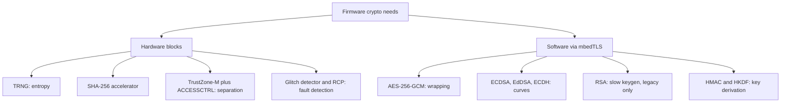
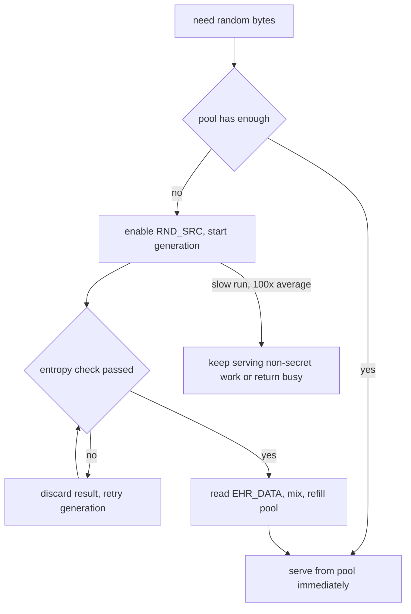
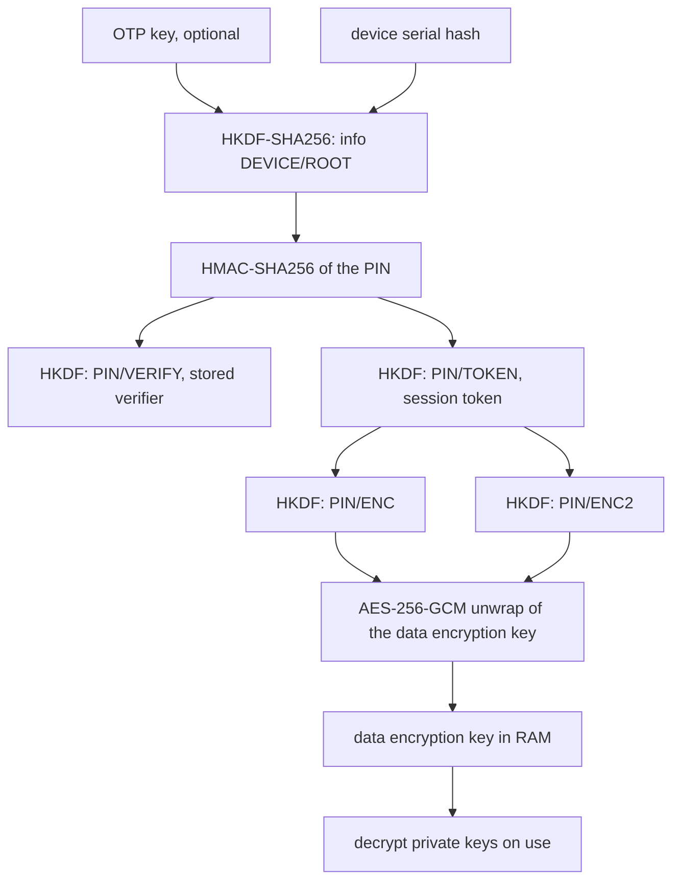
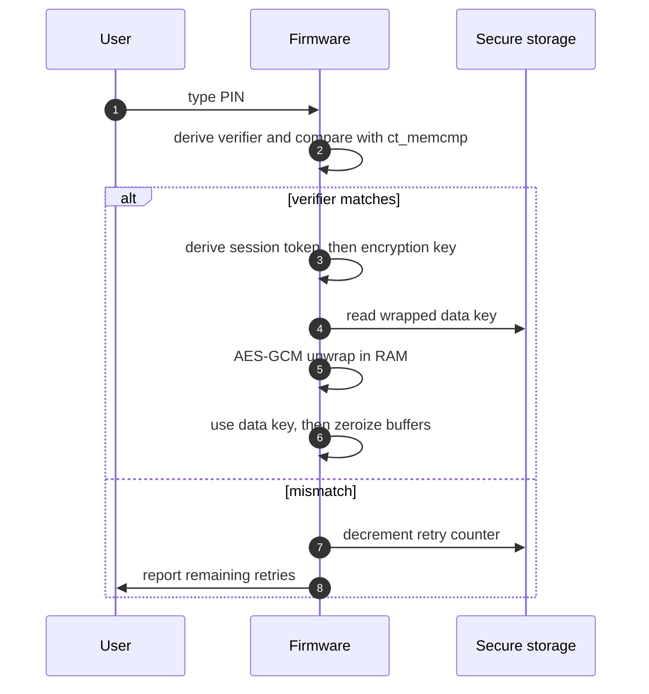
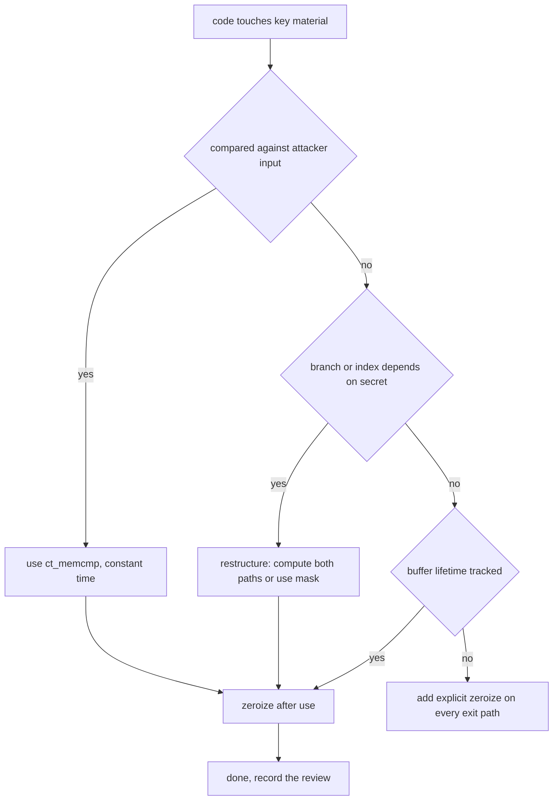
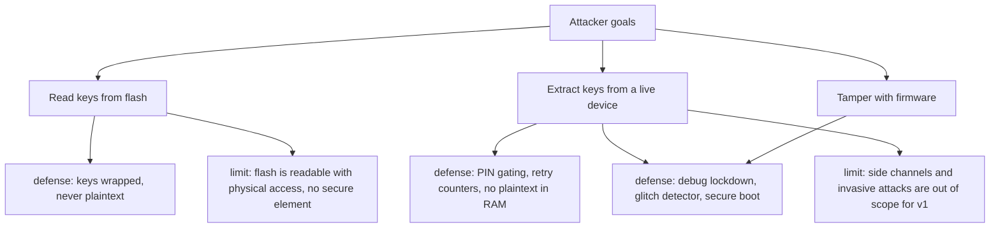
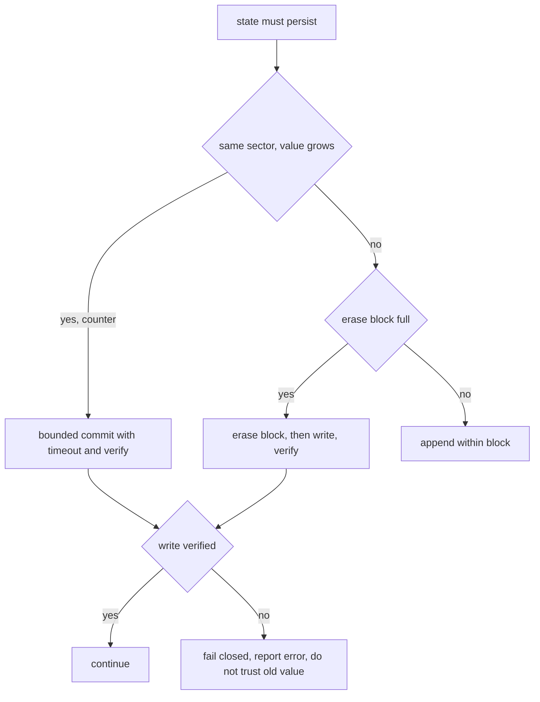

# 07 — Crypto on a small MCU

What is cheap, what is expensive, and what is dangerous when the crypto runs on a 150 MHz microcontroller with no secure element. Sources: RP2350 datasheet chapters 1, 10, 12.12, 12.13, plus the `pico-keys-sdk` crypto implementation as the working reference.

## What the chip accelerates, and what it does not

`cited` — RP2350 datasheet chapter 1 and the peripheral address map:

| Capability | Hardware | Notes |
| --- | --- | --- |
| Randomness | TRNG block (§12.12) | Arm IP block, 192 entropy bits per request |
| Hashing | SHA-256 accelerator (§12.13) | One algorithm only: SHA-256 |
| Symmetric crypto | none | AES runs in software (mbedTLS in the reference projects) |
| Public-key crypto | none | ECDSA, EdDSA, ECDH, RSA all run in software |
| Isolation | Arm TrustZone-M with SAU and IDAU, plus `ACCESSCTRL` peripheral domains (§10.2, §10.6) | Secure/non-secure split, not a hardware key vault |
| Fault resistance | Glitch detector (§10.9), redundancy coprocessor (§3.6.3) | Glitch detector needs an OTP flag to enable |
| Key storage | OTP, 8 kB (§13) | For boot keys and fingerprints, not for bulk credentials |

Practical consequence: every public-key operation is cycles off the CPU, and the SHA-256 accelerator exists but the reference projects do not wire it into mbedTLS, so their hashes are software too (`cited` — no `sha256_alt` or hardware SHA references found in `pico-keys-sdk`, `pico-fido`, or `pico-openpgp`). Using the accelerator is an open opportunity for this build, not a given.

## The numbers that shape the design

### TRNG

`cited` — datasheet §12.12:

- Claims compliance with FIPS 140-2, BSI AIS-31, and NIST SP 800-90B.
- Produces approximately **7.5 kb/s of entropy** when the core runs at 150 MHz.
- Each request yields **192 entropy bits**, sampled from an internal ring oscillator asynchronous to the system clocks.
- Recommended settings for roughly **2 ms** average generation: ROSC chain length 0 or 1, sample count 20 to 25.
- Caveat: generation is not deterministic in time. Runs can occasionally take **more than 100 times the average**, and any failed entropy check discards the result and requires a new generation. The datasheet suggests pooling random numbers instead of blocking on a single request.

That 2 ms typical case matters: a ceremony that needs several 32-byte secrets must not synchronously wait for each one.

### SHA-256 accelerator

`cited` — datasheet §12.13.2:

- One 512-bit block takes **at least 64 cycles** to write: sixteen 32-bit writes, and an APB register write costs 4 cycles.
- The core then takes **57 further cycles** to digest the block.
- Maximum throughput is therefore **one block per 121 system clock cycles, 0.53 bytes per cycle, 79.3 MB/s at 150 MHz** — and only with 32-bit DMA transfers. Narrower writes or CPU polling on `WDATA_RDY` are slower.
- Message padding follows FIPS 180-4, and the block count must be handled exactly: length in bits, appended as a 64-bit field.

Reading the API order matters for correctness as much as speed: start, write the message, write trailer and padding, wait for `SUM_VLD`, then read eight result registers.

### Budgets

| Resource | Size | What it means here |
| --- | --- | --- |
| SRAM | 520 kB in 10 banks | Enough for mbedTLS contexts; still worth measuring high-water mark |
| OTP | 8 kB, page-locked | Boot key hash, device keys, policy flags. Not a credential store |
| Flash | external QSPI, sector-erased | Credentials, wrapped keys, counters. Wear is real |

## Key hierarchy: how prior art protects secrets at rest

The reusable pattern, read from `pico-keys-sdk/src/crypto_utils.c`:

1. **Root**: `derive_kbase` runs HKDF-SHA256 over a device serial hash, salted with an OTP-held key when one exists, with info string `DEVICE/ROOT`, producing a 32-byte base key (`cited` — `crypto_utils.c:34`).
2. **Per-PIN key**: `derive_kver` computes HMAC-SHA256 of the base key over the PIN (`crypto_utils.c:44`).
3. **Domain-separated children**: HKDF from that value with distinct info strings — `PIN/VERIFY` for the stored verifier, `PIN/TOKEN` for the session token, then `PIN/ENC` and `PIN/ENC2` for encryption keys (`crypto_utils.c:51,58,65,69`).
4. **Wrapping**: AES-256-GCM with a random 12-byte nonce and the device serial hash as associated data, output laid out as `nonce || ciphertext || tag` (`crypto_utils.c:81`, and `:117` for the reverse).
5. **Hygiene**: `mbedtls_platform_zeroize` appears about 331 times across the three projects, and `mbedtls_ct_memcmp` about 32 times.

The design lesson: the PIN never encrypts the keys directly. It unlocks a data key, so a PIN change rewraps one value, and a forgotten PIN can still be recoverable through an administrative path if the design allows it.

## Constant-time discipline

Rules that apply to every line touching a secret:

- Compare secrets with a constant-time comparison (`mbedtls_ct_memcmp`), never with `memcmp` or a `==` on arrays.
- No secret-dependent branches, no secret-dependent table indexing, no secret-dependent loop bounds.
- Do not let a secret decide a length, an index, or a loop termination condition.
- Zeroize the moment a buffer is no longer needed, including all early-return and error paths.
- Never log, never print, never send a secret off-device.
- Treat the compiler as hostile: verify that optimized builds still call the constant-time helpers rather than substituting a fast path.

Timing and power analysis on software ECDSA and AES are a separate, harder class of problem. Countermeasures such as scalar blinding and randomized projective coordinates exist in the crypto library, but their usefulness should be treated as `inferred` until measured or reviewed against a specific attacker model.

## Fault injection, debug, and the honest limits

`cited` — datasheet §10.2, §10.6, §10.9, §3.6.3:

- TrustZone-M with SAU and IDAU gives a secure and non-secure split, and `ACCESSCTRL` assigns peripherals, GPIOs, and DMA channels to security domains. It is isolation, not key storage.
- The glitch detector detects out-of-envelope operation and halts the system; enabling it requires the `CRIT1.GLITCH_DETECTOR_ENABLE` OTP flag.
- The redundancy coprocessor is always used by the bootrom and detects integrity failures, including stack canaries against ROP.
- Boot signing is enforced by mask ROM with the key fingerprint in OTP.

The honest statement for this project: without a secure element, physical access plus effort equals compromise. The defenses we can build are wrapped storage, PIN gating with counters, debug lockdown, and secure boot — and the threat model in note 11 has to say which attacker we are actually resisting.

## Flash: the write path is the risk

- Every HOTP code consumes a counter write (note 04), which is a flash erase cycle pattern rather than a RAM update.
- PIN retry counters are updated on failure, and the implementation commits them with a bounded timeout and checks the write result before trusting it (`cited` — the `flash_commit_sync` pattern seen earlier in the OATH and PIN paths).
- Failed writes must fail closed: a counter that did not persist must not be treated as decremented.

## What to measure on hardware before committing

The task matrix requires numbers, not vibes. Suggested first measurement pass, to run once a board is on the bench:

| Measurement | Why it matters | Target placeholder |
| --- | --- | --- |
| TRNG latency distribution (min, median, p99, max) | Ceremony responsiveness | p99 under a few tens of ms with pooling |
| SHA-256 accelerator throughput vs software hash | Whether to wire mbedTLS to hardware | at least 3x software |
| ECDSA P-256 sign and verify time | Passkey registration and login latency | user-visible under ~1 s total per ceremony |
| Ed25519 sign time | Alternative algorithm choice | compare with P-256 |
| AES-256-GCM wrap and unwrap time | PIN flows, key unwrap | negligible relative to ECC |
| RSA-2048 and RSA-4096 keygen | Whether on-card RSA is ever viable | expected slow, decide from data |
| Flash write and erase duration, endurance budget | HOTP counters, credential churn | longest acceptable pause under a second |
| RAM high-water mark during a ceremony | 520 kB total, mbedTLS contexts are large | leave headroom for future features |
| Code size for crypto versus protocol code | Flash is shared with credentials | measure before adding features |

Record each result in this note or in a follow-up measurement note, labeled `measured`, with the firmware version and board identity.

## Decisions to make

- Whether to wire the SHA-256 accelerator into the crypto library or leave hashing in software.
- Which curves ship: P-256 alone, P-256 plus Ed25519, or more.
- Whether RSA exists at all, given software keygen cost on this core.
- Random pooling strategy: pool size, refill policy, and behavior when the pool is empty during a ceremony.
- Whether TrustZone-M separation is used from the start or retrofitted, since it changes the memory layout and every driver's security attribution.
- When the glitch detector flag goes into OTP, given OTP flags are irreversible.

## Open questions

- Which crypto library: carry mbedTLS as the reference projects do, or evaluate a smaller constant-time-focused library for the specific algorithms we ship.
- Whether to implement secret-dependent-operation protections (blinding) that are beyond the library defaults, and how to test them.
- How to verify constant-time behavior in practice on this target (tooling, differential timing, or review only).
- What the minimum viable secure-boot and debug-lockdown story is for a personal learning device, and what is explicitly out of scope.

## Sources

- RP2350 datasheet chapter 1 (feature list, 520 kB SRAM, 8 kB OTP, SHA-256 accelerator), §3.6.3 (redundancy coprocessor), §10.2 (TrustZone-M, SAU, IDAU), §10.6 (ACCESSCTRL), §10.9 (glitch detector and its OTP enable flag), §12.12 (TRNG: entropy rate, 192-bit blocks, recommended configuration, caveats), §12.13 (SHA-256 accelerator: register flow, padding, throughput), chapter 13 (OTP).
- [pico-keys-sdk source code](https://github.com/polhenarejos/pico-keys-sdk) `src/crypto_utils.c` — HKDF and HMAC derivations with domain-separated info strings, AES-256-GCM wrapping with nonce and tag, zeroization.
- [pico-keys-sdk source code](https://github.com/polhenarejos/pico-keys-sdk) `src/rng/hwrng.c` and `random.c` — TRNG use plus a mixing and buffering layer.
- [pico-fido source code](https://github.com/polhenarejos/pico-fido) and [pico-openpgp source code](https://github.com/polhenarejos/pico-openpgp) — mbedTLS usage as the practical crypto stack, `mbedtls_ct_memcmp` usage, no hardware SHA wiring.
- [RFC 5869](https://datatracker.ietf.org/doc/html/rfc5869) — HKDF, the derivation used for the key hierarchy.
- [NIST SP 800-38D](https://csrc.nist.gov/pubs/sp/800/38/d/final) — GCM, the mode used for wrapping.
- [FIPS 180-4](https://csrc.nist.gov/pubs/fips/180-4/upd1/final) — SHA-256 definition referenced by the accelerator section.
