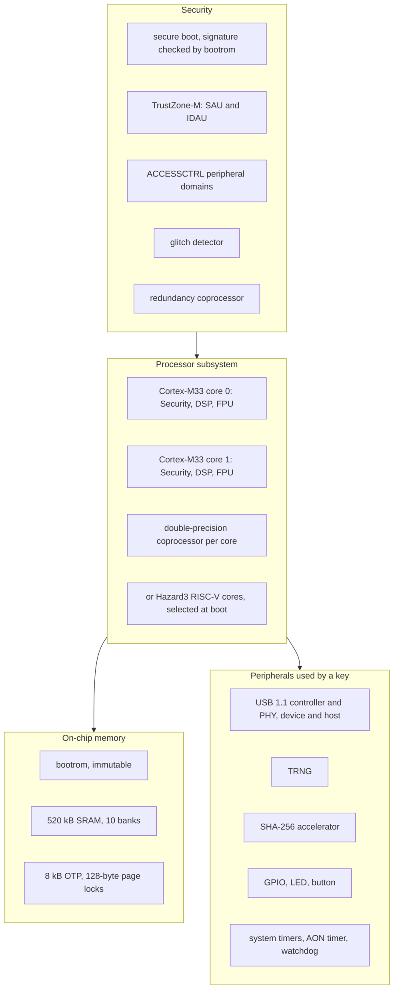
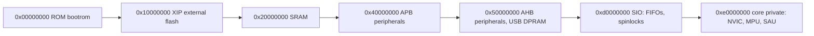
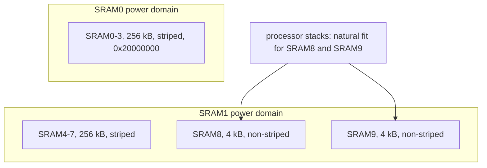
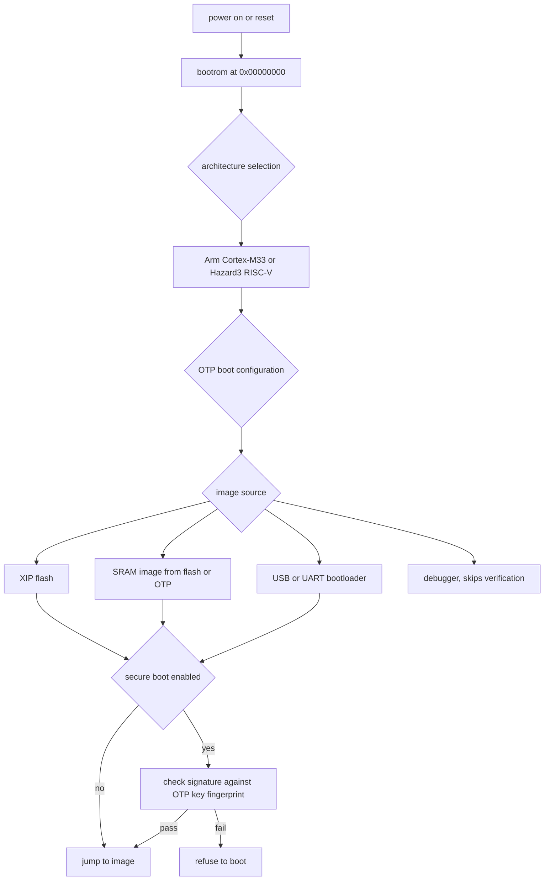
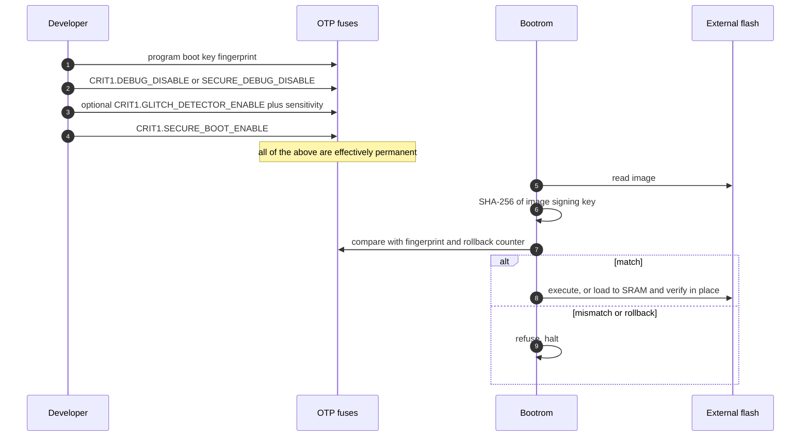

# 08 — RP2350: the chip

Know the silicon before trusting it. Sources: RP2350 datasheet chapters 1, 2, 3, 5, 10, 12, and 13, read locally. Everything here is `cited` to a chapter or section unless marked otherwise. Details that belong to a different layer live in the companion notes: USB in note 06, crypto primitives in note 07.

## Family and package options

`cited` — datasheet chapter 1, device family table:

| Variant | Package | GPIO | Flash |
| --- | --- | --- | --- |
| RP2350A | QFN-60, 7 × 7 mm | 30 | none (external) |
| RP2350B | QFN-80, 10 × 10 mm | 48 | none (external) |
| RP2354A | QFN-60 | 30 | 2 MB in package |
| RP2354B | QFN-80 | 48 | 2 MB in package |

The Pico 2 board carries the non-wireless RP2350 (see note 09 for which variant and flash arrangement; that is a board fact, not a chip fact).

## Cores

`cited` — datasheet §3.6 and the processor subsystem chapter:

- Two identical Arm Cortex-M33 processors, each configured with the **Security, DSP, and FPU** extensions.
- A **double-precision coprocessor** per core accelerates basic double-precision add, subtract, multiply, divide, and square root. It is not a full FPU register bank, just an accelerator for those operations.
- The Hazard3 RISC-V cores are an alternative build of the same subsystem, selectable at boot.
- Cores can sleep (`WFE`) and can be halted and unblocked in software; the Hazard3 unblock signals are cross-connected between processors.
- Interrupts: 46 system-level IRQs on RP2350, with six spare interrupts reserved for cores to interrupt themselves.

For this project the second core is a resource question, not an assumption: dual core is easy to reach for (one core runs USB, the other runs crypto) and easy to get wrong (shared state, cache coherency questions). Measure before splitting work.

## Memory map

`cited` — datasheet §2.2:

| Segment | Base | Notes |
| --- | --- | --- |
| ROM | `0x00000000` | bootrom, immutable, both cores start here |
| XIP | `0x10000000` | mirrors of a 64 MB space; lower 32 MB mapped to QMI for external flash or PSRAM |
| SRAM | `0x20000000` | 520 kB total, see below |
| APB peripherals | `0x40000000` | control and configuration registers; APB writes cost at least 4 cycles, reads at least 3 |
| AHB peripherals | `0x50000000` | higher-bandwidth peripherals, including the USB DPRAM window at `0x50100000` |
| Core-local peripherals (SIO) | `0xd0000000` | FIFOs between cores, spinlocks, GPIO access |
| Cortex-M33 private registers | `0xe0000000` | NVIC, SysTick, MPU, SAU |

Two consequences that bite in practice: instruction fetch from the APB segment always fails, so peripheral registers are data-only; and XIP performance depends on caching, so code execution speed is not uniform across the map.

## SRAM layout

`cited` — datasheet §2.2.3:

- SRAM0 through SRAM3 form a 256 kB region striped over four banks at `0x20000000`.
- SRAM4 through SRAM7 form a second 256 kB region striped over four banks.
- SRAM8 at `0x20080000` and SRAM9 at `0x20081000` are two non-striped 4 kB blocks, ending at `0x20082000`, which is where the 520 kB total comes from.
- SRAM0-3 live in the SRAM0 power domain, SRAM4-9 in the SRAM1 power domain.
- SRAM8 and SRAM9 suit high-bandwidth structures such as processor stacks.

## Boot

`cited` — datasheet chapter 5:

- The bootrom sits at address zero and runs first on both cores.
- Boot media include external flash over XIP, loading into SRAM from flash, loading from OTP contents, USB or other serial bootloaders, and the debugger.
- `BOOTSEL` gives a USB mass-storage boot path, and there is a `PICOBOOT` interface plus UART boot for recovery.
- A rescue reset sets a flag the bootrom checks, giving a way back from a device that looks bricked.
- Secure boot enforces signatures on all boot media **except the debugger**: a debugger has direct control of the processors and can skip the bootrom entirely. That is why the secure boot procedure disables debug.

## Secure boot and OTP

`cited` — datasheet §10.5, §10.9, §13:

- OTP is **8 kB**, protected at **128-byte page granularity**. Page locks can restrict key access so that only a small set of trusted code can read it.
- Secure boot works by comparing a SHA-256 hash of the image's signing key against a fingerprint stored in OTP, then refusing images below an anti-rollback counter also held in OTP.
- The documented enable procedure is an ordered, largely irreversible sequence: install the boot key so a later attacker cannot install their own, disable debugging by programming `CRIT1.DEBUG_DISABLE` or `CRIT1.SECURE_DEBUG_DISABLE`, optionally enable the glitch detector with `CRIT1.GLITCH_DETECTOR_ENABLE` and a sensitivity setting, then enable secure boot with `CRIT1.SECURE_BOOT_ENABLE`.
- The datasheet warns against verifying an XIP image and then executing from flash, because flash contents can change between check and execution (an attacker can emulate a QSPI device). Its recommendation: load the application into SRAM and verify it there, which the SRAM capacity makes practical.

Consequence for this repo: OTP decisions belong in a decision document with a risk and rollback section, and must be rehearsed on a development board first. There is no undo.

## Peripherals that matter for a USB key

`cited` — datasheet chapter 1 and chapter 12:

| Peripheral | Use in this project | Note |
| --- | --- | --- |
| USB 1.1 controller and PHY | the whole point: device mode for HID and CCID | details in note 06 |
| TRNG | keys, nonces, salts | ~7.5 kb/s, plan pooling (note 07) |
| SHA-256 | hashes, secure boot | may or may not be wired into the crypto library (note 07) |
| GPIO, pads | LED, button for user presence | check pad and errata notes before relying on pulls |
| System timers, AON timer | keepalive timing, timeouts | no battery-backed RTC by default |
| Watchdog | recovery from firmware hangs | consider in release images |
| PIO, HSTX | not needed for the MVP | extra interfaces only with justification |
| UART, SPI, I2C, PWM | debugging and future hardware | keep out of release builds unless used |

## Errata to check before trusting a peripheral

The datasheet lists device errata; three seen while reading for these notes: **RP2350-E2** (writes to new SIO registers above an offset alias the spinlocks), **RP2350-E3** (on RP2350A, access to `PADS_BANK0` registers is controlled by the wrong bit), and **RP2350-E12** in the USB chapter. Before depending on a peripheral, check the current errata list for the chip revision in hand, and record the finding and the workaround in the relevant note. Treat any peripheral-specific claim in this repo as provisional until then.

## What the chip cannot do

- No secure element and no key vault. Flash is readable with physical access, so secrets must be wrapped and the debug port must be closed for a release image.
- No AES or public-key accelerator. AES-GCM, ECDSA, EdDSA, and RSA are software CPU cost (note 07).
- OTP is small and irreversible: 8 kB for boot keys, fingerprints, and flags, not for credentials.
- No wireless, by design of this board choice.
- TrustZone-M separates secure and non-secure code, but separation alone does not protect keys from an attacker who can glitch or probe the die.

## Decisions to make

- Which core(s) are used, and whether any work is split across them.
- Whether the application runs from XIP or is loaded into SRAM (the datasheet's recommendation for verified execution points at SRAM).
- What goes into OTP, in what order, and when in the project timeline, with a rehearsal on disposable hardware.
- Which chip revision and variant the project targets, and whether the errata list changes any plan.
- Whether TrustZone-M is used from day one or retrofitted.

## Open questions

- Which RP2350 errata apply to the specific chip revision on hand, and which of them touch USB, pads, or flash.
- How much of the 520 kB is genuinely available after the crypto library, USB stack, and credential buffers (needs a measurement).
- Whether secure boot is worth enabling for a personal learning device, given the irreversibility.
- What the SRAM-load boot path implies for firmware update and recovery flows.

## Sources

- RP2350 datasheet chapter 1 (introduction, device family, feature list), §2.2 (address map, XIP, SRAM, APB and AHB segments), §3.6 (coprocessors), chapter 5 (boot, boot media, debugger exception), §10.5 (secure boot enable procedure), §10.9 (glitch detector), chapter 12 (peripherals: USB, TRNG, SHA-256, timers), chapter 13 (OTP, page locks), plus the errata list for RP2350-E2, RP2350-E3, RP2350-E12.
