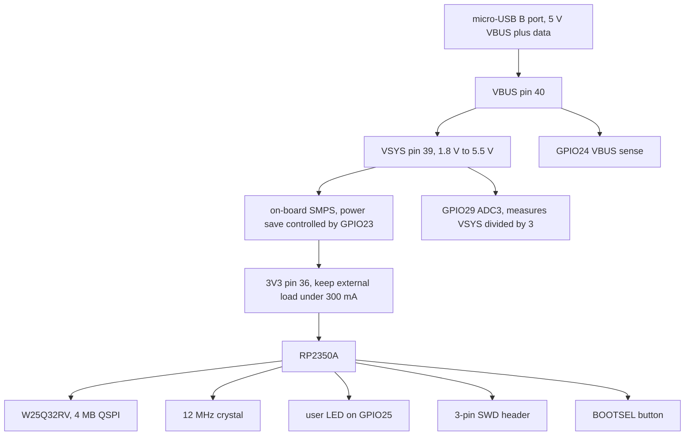
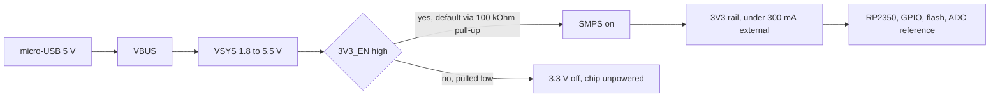
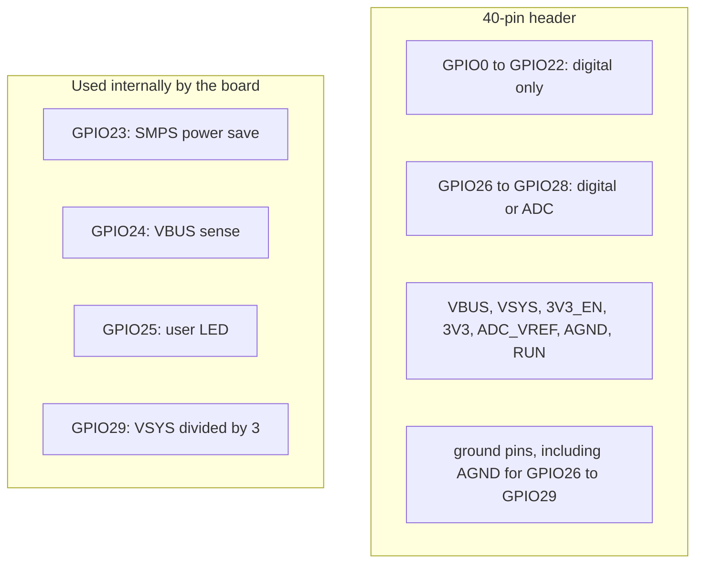
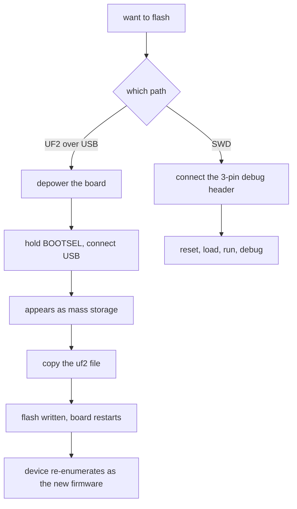
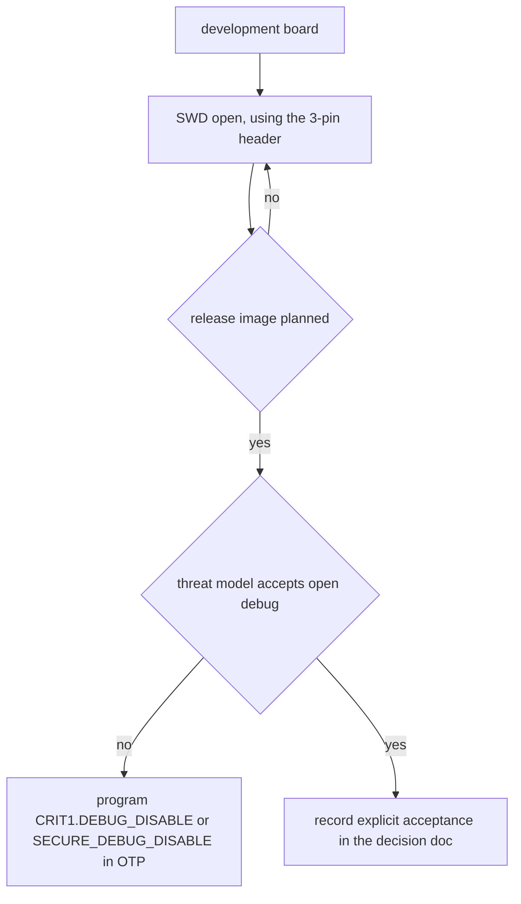
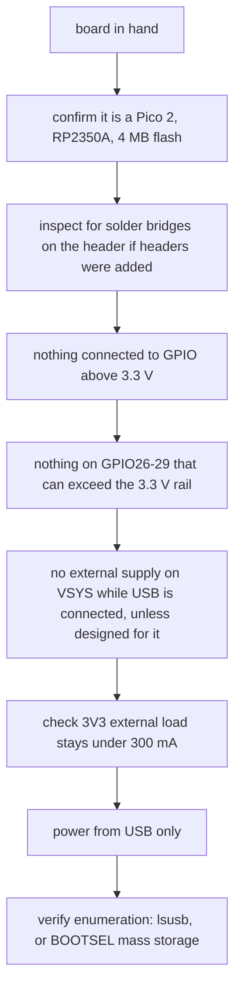

# 09 — Pico 2: the board

Board facts, verified against the [Raspberry Pi Pico 2 datasheet](https://datasheets.raspberrypi.com/pico/pico-2-datasheet.pdf) (24 pages, revision history through 2026). Everything here is `cited` to that document unless marked otherwise. Board facts are separate from chip facts: the RP2350 datasheet does not tell you what is soldered around it, and the board datasheet does.

## What is on the board

`cited` — Pico 2 datasheet, introduction and section 5:

| Part | Detail |
| --- | --- |
| Microcontroller | RP2350A |
| Flash | 4 MB QSPI, Winbond W25Q32RV |
| Crystal | Abracon ABM8-272-T3, 12 MHz |
| USB | micro-USB B, for power, data, and flash reprogramming |
| GPIO on header | 26 of the 30 available, 3.3 V only |
| Debug | SWD on a 3-pin header on the lower edge |
| Extras | BOOTSEL button, user LED, castellated edges, test points TP1-TP7, SMT pads under the USB connector and BOOTSEL for module use |

The board is described as minimal external circuitry: flash, crystal, power supplies, decoupling, USB connector, and the button and LED.

## Power chain

`cited` — datasheet section 5.4 and section 5.5:

- **VBUS** is the micro-USB input, nominally 5 V, and reads 0 V when unplugged or unpowered.
- **VSYS** is the main system input, allowed range **1.8 V to 5.5 V**, feeding the on-board SMPS that generates 3.3 V.
- **3V3_EN** connects to the SMPS enable pin and is pulled high to VSYS through 100 kΩ; pulling it low disables 3.3 V and therefore de-powers the RP2350.
- **3V3** powers the RP2350 and its I/O. External loads on this pin should stay **under 300 mA**, dependent on RP2350 load and VSYS.
- **ADC_VREF** is a filtered 3.3 V reference; an external reference is possible if better ADC performance is wanted.
- **AGND** is the analog ground for GPIO26-29, with its own plane.
- **RUN** is the enable pin with an internal pull-up of about 50 kΩ to 3.3 V; shorting it low resets the chip.

For this project: the board runs from USB power only, and that is the plan until a reviewed external-supply design exists. Note the numbers to respect: VSYS 1.8-5.5 V, 3V3 external load under 300 mA, and no mains anywhere near this work.

## GPIO reality on the header

`cited` — datasheet section 5.2:

- GPIO on the header is powered from the 3.3 V rail, and the board datasheet states the IO voltage is **fixed at 3.3 V** (`cited` — datasheet feature list and section 5.2). Derived rule: treat every header pin as 3.3 V only and never drive 5 V into it (`inferred` from the fixed rail; the board datasheet does not claim 5 V tolerance on the header).
- The board exposes 26 pins: **GPIO0 to GPIO22** are digital only; **GPIO26, GPIO27, GPIO28** can be digital or ADC; **GPIO29** is used internally as ADC3 to measure VSYS divided by 3.
- The ADC-capable pins GPIO26-29 have an internal reverse diode to the 3.3 V rail, which limits what can safely be connected to them.
- Four chip pins are consumed by the board: **GPIO23** drives the SMPS power-save input, **GPIO24** senses VBUS, **GPIO25** drives the user LED, and **GPIO29** senses VSYS.

The button and LED are the parts of this project's user interface that already exist: LED on GPIO25 for state, BOOTSEL for flashing. User presence for FIDO2 and OpenPGP still needs its own input — the BOOTSEL button is wired to the bootrom's role, so a dedicated button is a Phase 12 hardware question, not a freebie.

## Programming the flash

`cited` — datasheet section 5.1:

1. Depower the board.
2. Hold BOOTSEL down while connecting USB.
3. The board enumerates as a USB mass-storage device.
4. Drag a `.uf2` file onto the volume; the file is written to flash and the board restarts.

The USB boot code lives in ROM, so it cannot be accidentally overwritten. SWD is the alternative path: it can reset the system and load and run code without any button presses, and it also supports interactive debugging.

Note for the USB work in note 06: BOOTSEL mode and our firmware are different USB devices, so the host sees the device disappear and return with different identifiers each time you flash.

## Debug

`cited` — datasheet section 5.8: SWD is brought to a 3-pin header on the lower edge, with internal pull-ups of roughly 60 kΩ on SWDIO and SWCLK inside the chip.

Disposition for this project, matching the `AGENTS.md` rule: SWD stays available during development, and any release image either uses OTP to disable debug or explicitly records the acceptance of leaving it open. That decision belongs with the threat model (Phase 11) before any release image exists.

## Before applying power: checklist

## Board facts still to verify by inspection

The datasheet gives the specification, not the unit on the desk. Before trusting any of it, check with your own eyes and record the result:

| To verify | How | Record |
| --- | --- | --- |
| Chip revision marking on the RP2350A | read the package marking against the datasheet's marking section | revision determines which errata apply (note 08) |
| Flash marking is W25Q32RV | read the 8-pin flash package | 4 MB confirmed |
| Board revision | silkscreen and the datasheet's release history | which board revision the notes describe |
| USB connector is micro-B and undamaged | visual inspection | connector type confirmed for host cables |
| BOOTSEL button works | hold it while plugging in, look for mass storage | button functional |
| LED on GPIO25 | blink test after first flash | LED functional |
| SWD header present and wired | visual inspection, then a debugger attach | debug path usable |

`inferred`: the ordering of these checks is mine, not the datasheet's; the parameters are all `cited` from the sections above.

## What this board is not

- Not wireless. The Pico 2 W is a different product; this project deliberately uses the non-wireless board.
- Not a secure element carrier. Everything secret lives on the RP2350 and in the external flash, which is exactly why wrapped keys and debug lockdown matter (note 07).
- Not a battery device. There is no battery, no charger, and no battery-backed clock, so TOTP time has to come from the host or from a future hardware addition.
- Not 5 V tolerant on the header, despite the chip's 5 V-tolerant powered GPIOs; the board fixes the I/O rail at 3.3 V and the datasheet says so plainly.

## Decisions to make

- Where the user-presence button comes from, given BOOTSEL is taken.
- Whether the LED on GPIO25 is enough feedback for enrollment, signing, and error states.
- Whether to use the SWD header plus a debug probe, or BOOTSEL-only flashing for the first spike.
- Whether any external part (button, capacitor, second flash or PSRAM) is added, and on what schematic evidence.
- What is recorded as the board identity in verification reports (board revision, chip revision, flash marking).

## Open questions

- Which board revision is physically in hand, and does it change any pinout or power detail in this note.
- Whether the ADC's VSYS measurement is worth using for a low-power warning, or is pure noise for this project.
- How much of the 4 MB flash should be reserved for credentials versus firmware, once credential storage and secure boot are on the table.
- Whether a second board is bought specifically for OTP rehearsal, since OTP changes are permanent (note 08).

## Sources

- [Raspberry Pi Pico 2 datasheet](https://datasheets.raspberrypi.com/pico/pico-2-datasheet.pdf) — introduction and features, pin list (VBUS, VSYS, 3V3_EN, 3V3, ADC_VREF, AGND, RUN), section 5.1 programming the flash, section 5.2 GPIO limits, section 5.3 ADC notes, section 5.4 powerchain, section 5.5 powering, section 5.7 USB, section 5.8 debugging, Appendix B schematic, Appendix C component locations, Appendix D release history.
- [RP2350 datasheet](https://datasheets.raspberrypi.com/rp2350/rp2350-datasheet.pdf) — chip-level facts referenced from note 08 (errata, OTP, secure boot, security features).
