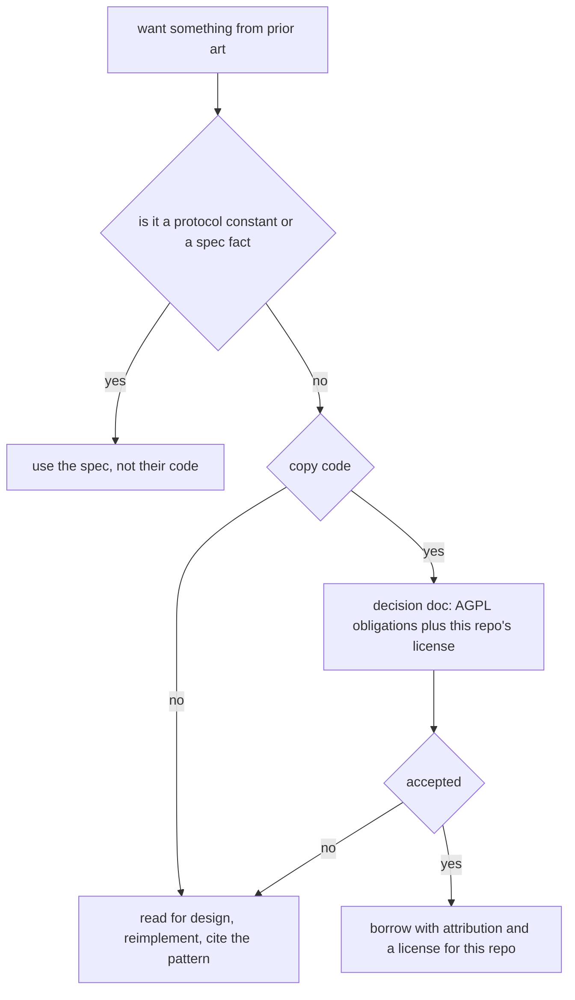
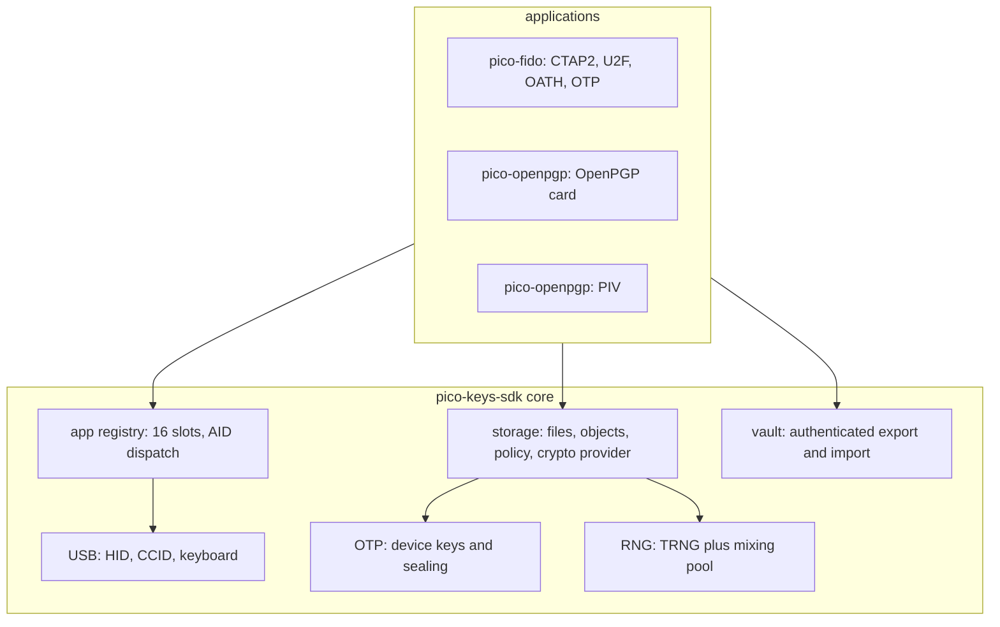
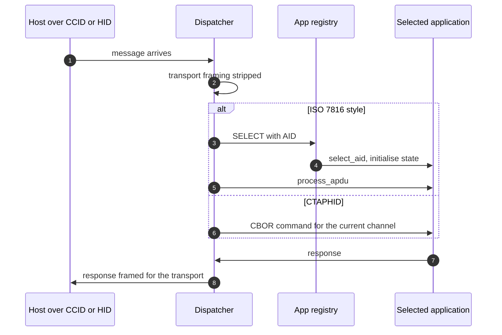
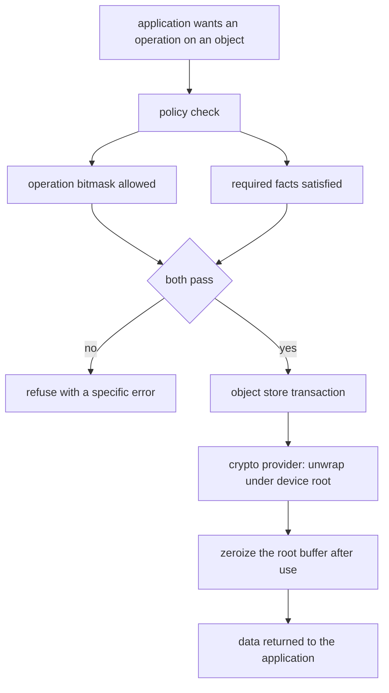
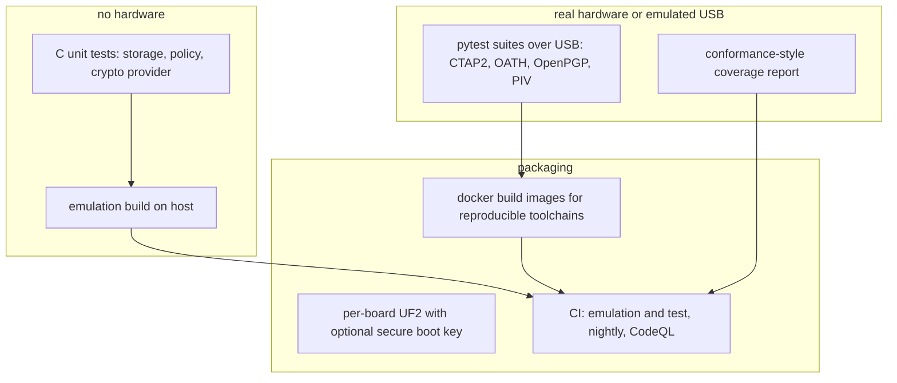

# 11 — Prior art dissected

Architecture lessons from the projects that already implement this feature set: three C projects on this board family, and `r17c`, the Rust firmware this project ports. Sources are local clones and the vendored copy in `dump/`; measurements (`measured`) come from those trees at the commits listed in Sources, and design claims (`cited`) name the file that shows them. The C clones live in `ref/repos/`.

## Inventory

| Project | Role | License | Files | Lines | Tests |
| --- | --- | --- | --- | --- | --- |
| `pico-fido` | FIDO2/U2F/OATH/OTP application | AGPL-3.0 | 49 | 16,602 | 19 pytest files, 234 test functions |
| `pico-openpgp` | OpenPGP and PIV smartcard application | AGPL-3.0 | 52 | 9,659 | 71 pytest files, 132 test functions |
| `pico-keys-sdk` | shared core: USB, storage, crypto, vault | AGPL-3.0 | 107 | 30,400 | 3 C test files, 47 test functions |
| `r17c` | Rust firmware: FIDO2, OpenPGP, OATH on RP2040 | none upstream, permission granted by the author | 20 | ~6,200 | none published |

About 57,000 lines of C across the three, all under the GNU Affero General Public License version 3. The three are meant to be composed: the applications depend on the SDK, and the SDK is a git submodule inside each application (`cited` — `.gitmodules` in both apps).

## License is the first decision, not the last

AGPL-3.0 is strong copyleft with a network-use clause. Studying these projects is unrestricted. Copying code into our firmware makes our firmware AGPL-3.0, and offering that firmware as a network service triggers source-disclosure obligations. Concretely for this repo:

- Reading for architecture, algorithms, and protocol structure: fine, and what this note does.
- Copying functions or files: only with an explicit decision record, an AGPL-compatible license for this repo, and awareness of the obligations.
- This repo currently has no `LICENSE` file. Add one before any code lands, and before any borrowing.

## Composition model: one firmware, many applications

The SDK core exposes a registry of applications selected by AID (`cited` — `pico-keys-sdk/src/main.c`: `app_t apps[16]`, `register_app()` at line 65, `select_app()`), and each application registers its own selector. `pico-openpgp` registers one at `src/openpgp/openpgp.c:1299`; `pico-fido` registers its own, and `pico-openpgp` also carries a PIV application in `src/piv`.

The `app_t` shape is small and worth copying as a pattern (`cited` — `pico-keys-sdk/src/apdu.h:28-34`): an AID, a `process_apdu` handler, a `select_aid` hook, an `unload` hook, and a flag for secure messaging support.

## r17c: the Rust reference this project ports

`r17c` lives in [`r17x/universe`](https://github.com/r17x/universe) under `apps/r17c`, commit `12a0bca`, authored by `r17x` on 2026-09-22. About 6,200 lines of Rust. Local copy: `dump/universe/apps/r17c` (gitignored).

Why it matters more than the C projects for our build:

- It targets the same feature set we plan: FIDO2/CTAP2 with Client PIN and discoverable credentials, an OpenPGP 3.4 card with three P-256 slots, and OATH TOTP/HOTP, all as a USB composite device.
- It is Rust on Embassy, the exact stack chosen for this project, with RustCrypto for crypto and no secure element.
- It proves CCID on `embassy-usb` is practical: a hand-written class in `src/usb/ccid.rs`, 208 lines, against embassy's driver traits.
- Its storage design is directly reusable in shape: sector-aligned regions, staging sectors for compaction, a monotonic counter with many 32-bit slots, credentials that survive reflashing.
- Its limitations are the porting work: RP2040 only, ROSC entropy instead of the RP2350 TRNG, a BOOTSEL-button trampoline for user presence, no RSA.

Permission and credit: the author granted permission to copy and modify. There is no `LICENSE` file upstream, so the permission is the basis for reuse, and both our repositories stay private until that changes or a written grant covering redistribution is recorded. When porting: per-file origin headers, a `NOTICE` entry naming project, author, and commit, commit provenance that preserves the original author, no stripping of upstream comments, and fixes offered back upstream. The full requirement list sits in [`docs/reviews/toolchain.md`](../docs/reviews/toolchain.md).

| Area | r17c approach (RP2040) | Our port (RP2350) |
| --- | --- | --- |
| Target | `thumbv6m-none-eabi`, `embassy-rp` feature `rp2040` | `thumbv8m.main-none-eabihf`, feature `rp235xa` |
| Entropy | ROSC bit sampling | hardware TRNG with pooling |
| Flash map | 2 MB board, seven sector regions | 4 MB board, offsets re-derived |
| User presence | BOOTSEL via QSPI-CS trampoline | dedicated GPIO button |
| RAM budget | 264 KB SRAM, 64 KB heap | 520 KB SRAM |
| Extra available | none | secure boot, OTP debug lock, TrustZone-M, SHA-256 accelerator |

## The generic storage and authorization layer

This is the most transferable idea in the SDK. Key material is not special-cased per application; it lives in an object model with an explicit policy:

- Object containers, stores, and transactions are separate layers (`cited` — `pico-keys-sdk/src/fs/object_container*.c`, `object_store*.c`, `object_store_txn.c`).
- A crypto provider wraps objects with a device-bound root key, validates the namespace, and zeroizes the root buffer after every callback (`cited` — `src/fs/object_crypto_provider.h`: root-key loader, optional public root for manifests and authenticated-public records, identity validator).
- Policy is a bitmask of allowed operations plus a set of facts that must hold (`cited` — `src/fs/object_policy.h`): operations include `READ`, `ENUMERATE`, `USE`, `SIGN`, `DECRYPT`, `DERIVE`, `WRAP`, `UNWRAP`, `EXPORT`, `UPDATE`, `DELETE`, `CHANGE_POLICY`, `ADMIN_RECOVERY`; facts include `USER_PRESENCE`, `USER_VERIFICATION`, `APP_PIN`, `ADMIN`, `SECURE_MESSAGING`, `INTERNAL_FIRMWARE`. Rules are capped at 8 per object, 14 bytes each.

Adopt a simplified version of this: one object type, one policy check function, one wrap and unwrap path, and explicit transactions for counter updates.

## Application-specific lessons

### pico-fido

- One file per CTAP2 command (`cbor_make_credential.c`, `cbor_get_assertion.c`, `cbor_client_pin.c`, `cbor_cred_mgmt.c`, `cbor_large_blobs.c`, `cbor_config.c`, `cbor_reset.c`, `cbor_selection.c`), with shared CBOR helpers in `cbor.c`. This is the kind of file split our repo's matrix expects for a medium-sized feature set.
- Separate containers per credential kind: `credential.c`, `resident_container.c`, `oath_container.c`, `otp_container.c`.
- A real-world quirks table: `known_apps.c` maps RP ID hashes to labels plus per-application overrides for sign-count behavior and self-attestation. This is the kind of compatibility knowledge that only shows up against real services.
- A published conformance coverage report (`tests/fido-alliance-conformance-results.md`) records an internal run summary of 251 passes and 0 failures, restated in original wording, and explicitly states it does not claim FIDO Alliance certification. Copy that evidence style: report what was exercised, and never claim certification without one.

### pico-openpgp

- One file per APDU command (`cmd_select.c`, `cmd_verify.c`, `cmd_change_pin.c`, `cmd_reset_retry.c`, `cmd_pso.c`, `cmd_internal_aut.c`, `cmd_keypair_gen.c`, `cmd_import_data.c`, `cmd_get_data.c`, `cmd_put_data.c`, `cmd_select_data.c`, `cmd_challenge.c`, `cmd_terminate_df.c`, `cmd_activate_file.c`, `cmd_mse.c`), plus a data-object layer (`do.c`) and its own file layout (`files.c`).
- Private keys live in a key container with per-key metadata (`key_container.c`), and the application also ships PIV as a second AID, which is direct evidence that one firmware can host several card applications at once.

## Verification tooling worth copying

- **Emulation build**: the SDK supports building for the host with `ENABLE_EMULATION` (`cited` — `pico-keys-sdk/src/usb/emulation/emulation.c`, `openssl.c`, and `tests/CMakeLists.txt` which defines it for the object store test). That is how they get fast, hardware-free tests.
- **C unit tests with CTest** for the storage and policy layers (`object_store_test.c`, `object_policy_test.c`, `object_crypto_provider_test.c`, 47 test functions).
- **pytest over real USB** for protocol behavior, with Docker builds to pin the toolchain (`pico-fido/tests/`, `pico-openpgp/tests/`, each with `docker/` and `run-test-in-docker.sh`).
- **CI**: a workflow literally named "Emulation and test", plus nightly and CodeQL (`pico-fido/.github/workflows/`).
- **Build and release**: CMake with `-DPICO_BOARD=pico|pico2` and an optional `SECURE_BOOT_PKEY`, producing a per-board UF2 (`pico-fido/build_pico_fido.sh`). The SDK also carries an `ESP_PLATFORM` branch, so the same core targets a second chip family.

## Borrow, rewrite, avoid

| Item | Verdict | Reasoning |
| --- | --- | --- |
| App registry with AID dispatch (`app_t`) | **Borrow the pattern**, reimplement | small, generic, and exactly what multiple features need |
| Object policy model (operations plus facts) | **Borrow a simplified version** | strong idea, but 8 rules at 14 bytes each is more machinery than a first version needs |
| Device-root key hierarchy and AES-GCM wrapping | **Borrow the design, cite it** | already reflected in note 07; reimplement with our own code |
| Emulation build and C unit tests | **Borrow the practice** | fast feedback without hardware, and it fits our verification gate |
| Conformance coverage reporting style | **Borrow the practice** | honest evidence without overclaiming |
| Container and file layout details (EF identifiers, TLV tags) | **Rewrite from the specs** | spec-derived values belong to spec citations, not to a copy of their tables |
| CTAP2 or APDU handler code | **Avoid copying** | AGPL obligations, and the spec is the better teacher |
| ESP32 and lwIP paths | **Avoid entirely** | out of scope for this board |
| Vault credential export and import | **Read the proposal, decide later** | it is a designed feature with trust boundaries; a real decision doc is needed (see below) |

## What prior art does not answer for us

- Our threat model: they publish a vault proposal, but the risk acceptance for OTP fuses, debug lockdown, and PIN policy on a personal device is ours to write (Phase 11).
- Our measurements: their numbers are for their builds on their boards. Note 07's measurement table is still empty.
- Our feature scope: they ship everything; we still have to choose a first slice.
- Our repo conventions: task matrix, labeled evidence, decision records. Their repos do not have our process, and we should not import theirs wholesale.

## The vault question

`pico-fido/docs/vault/vaulted_passkeys_proposal.md` documents authenticated credential export and import, with sections for assets and trust boundaries, roles, assumptions, and non-goals. It matters to us because FIDO2 credentials and OpenPGP keys on a DIY device have no vendor backup story, and a failed flash means losing every credential.

Decision needed later, not now: no export, vendor-style encrypted backup, or a documented reset-and-re-enroll policy. Whichever path is chosen, this repo's `AGENTS.md` requires a threat model entry, an encrypted-backup design, and an explicit statement about private keys leaving the device.

## Sources

Cloned locally at `ref/repos/`, shallow clones, read on 2026-09-24. The `r17c` tree is vendored at `dump/universe/apps/r17c` (gitignored), read 2026-09-27:

- [r17c / r17x/universe](https://github.com/r17x/universe) — `apps/r17c`, commit `12a0bca` (2026-09-22), GitHub user `r17x`. Files: `src/fido2.rs`, `src/ctaphid.rs`, `src/openpgp.rs`, `src/oath.rs`, `src/oath_ccid.rs`, `src/storage.rs`, `src/crypto.rs`, `src/cbor.rs`, `src/usb/{ccid,hid,mod}.rs`, `r17c.nu`, `Cargo.toml`, `README.md`. No `LICENSE` upstream; used with the author's permission.

- [pico-fido source code](https://github.com/polhenarejos/pico-fido) — commit `c260981`, 2026-09-22. Files: `src/fido/*.c`, `src/fido/known_apps.c`, `tests/`, `tests/fido-alliance-conformance-results.md`, `docs/vault/vaulted_passkeys_proposal.md`, `build_pico_fido.sh`, `.gitmodules`, `.github/workflows/`, `LICENSE`.
- [pico-openpgp source code](https://github.com/polhenarejos/pico-openpgp) — commit `50d024d`, 2026-09-18. Files: `src/openpgp/*.c` (command per file, `do.c`, `files.c`, `key_container.c`), `src/piv`, `tests/`, `LICENSE`.
- [pico-keys-sdk source code](https://github.com/polhenarejos/pico-keys-sdk) — commit `d075b18`, 2026-09-22. Files: `src/main.c` (app registry), `src/apdu.h` (`app_t`), `src/fs/*` (object container, store, transaction, policy, crypto provider, vault container), `src/usb/*` (HID, CCID, descriptors, emulation), `src/rng/*`, `src/otp/*`, `src/vault.c`, `tests/`, `CMakeLists.txt`, `LICENSE`.
- Line and file counts are `measured` with `find` and `wc -l` over each clone; test counts are `measured` with `grep`.
